# `kqring` Architecture

`kqring.ko` is a loadable FreeBSD 15.1 kernel module implementing the Linux `io_uring` ABI over `/dev/kqring`. Its fast path is the **`IORING_SETUP_SINGLE_ISSUER | IORING_SETUP_DEFER_TASKRUN`** execution model; rings shared by the threads of a process and rings without `DEFER_TASKRUN` are built on the same serialized issuer (section 3).

Three ideas shape the design:

- **One writer for the completion queue.** Upcalls, timers, workers and disk callbacks only queue work. Results are posted from one serialized place, so the CQ needs no lock against the program (section 3).
- **Try it now, and wait only if you must.** A request runs inline on the submitting thread when it can't block. What has to wait is parked on the cheapest thing available: a socket upcall, a knote, a disk driver, or at worst a worker thread (section 4).
- **Everything lives in the owner's process.** Workers are threads of the process that made the ring, so user addresses and credentials work directly, and a ring stays bound to one process (sections 3a and 9).

| Section | Topic |
|---|---|
| [1](#1-module--source-layout) | Source layout |
| [2](#2-shared-memory-layout-fo_mmap) | Shared memory |
| [3](#3-execution-model) | Execution model and kernel threads |
| [4](#4-request-lifecycle--state-machine) | Request lifecycle, and where a request goes |
| [5](#5-socket-fast-path--upcall-arming-kqring_sockc) | Sockets, and polls on other files |
| [6](#6-zero-copy-transmit-send_zc--sendmsg_zc) | Zero-copy send |
| [7](#7-in-process-worker-pool--detached-cancellation-kqring_wqc) | Workers, disk I/O, ordering, cancellation |
| [8](#8-locking-hierarchy--concurrency-invariants) | Locks |
| [9](#9-process-lifecycle--security-boundaries) | Process lifecycle and security |
| [10](#10-kqring-extensions) | Extensions beyond io_uring |
| [11](#11-how-its-tested) | How it's tested |

**Colors in the diagrams** mean the same thing throughout: dark blue is the program, light blue the kernel core that issues and completes requests, green the code that runs operations, orange worker threads, amber memory and registered resources, pink queues and rings, and gray anything else. In the lock order diagram, orange marks the locks that can sleep.

---

## 1. Module & Source Layout

The kernel module (`kmod/`) is split into eleven translation units sharing a single private header ([`kmod/kqring_var.h`](kmod/kqring_var.h)) and one public UAPI header ([`include/sys/kqring.h`](include/sys/kqring.h)):

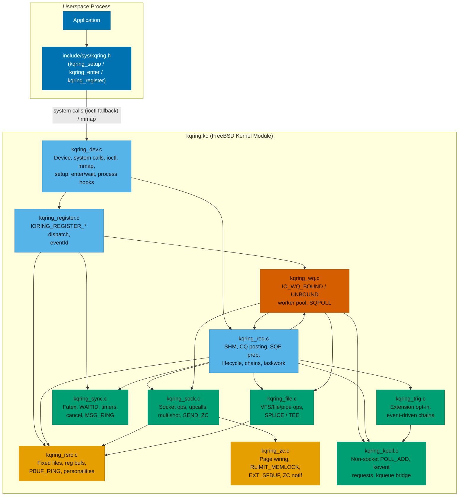

| File | Responsibility |
|---|---|
| [`include/sys/kqring.h`](include/sys/kqring.h) | Dual kernel/userspace UAPI header: `io_uring_sqe`, `io_uring_cqe`, `io_uring_params`, `io_uring_buf_ring`, `/dev/kqring` ioctls, opcode/flag constants, and inline userspace wrappers (native system calls, found through `kern.kqring.sys_*`, with the ioctls as fallback). |
| [`kmod/kqring_var.h`](kmod/kqring_var.h) | Kernel-internal structs (`kqring_ctx`, `kqring_op`, `kqring_wq`, `kqring_rsrc`, `kqring_bgroup`, `kqring_zc_buf`, `kqring_zc_notif`), limits, cross-TU prototypes, and hot-path `static inline` helpers. |
| [`kmod/kqring_dev.c`](kmod/kqring_dev.c) | `/dev/kqring` `cdevsw` (`d_fdopen` only) and the ring file's own `struct fileops` (`kqring_ioctl`, `kqring_poll`, `kqring_kqfilter`, `kqring_mmap`, `kqring_close`, `kqring_fork`), the `kqring_setup(2)` / `kqring_enter(2)` / `kqring_register(2)` system calls (registered in free `sysent` slots at load and drained at unload), ring setup/teardown, `kqring_wait_cqes`, process `exit`/`exec`/`fork` eventhandlers, and module load/unload. |
| [`kmod/kqring_req.c`](kmod/kqring_req.c) | OBJT_DEFAULT shared memory allocation, CQ ring posting and overflow queue, SQE preparation (`SUBMIT_STABLE` copyin), request allocation/free, chain/drain scheduling, and deferred taskwork execution. |
| [`kmod/kqring_rsrc.c`](kmod/kqring_rsrc.c) | Reference-counted fixed files (`ctx->files`) with Capsicum rights, registered buffers (`ctx->bufs`), classic & mmap provided-buffer rings (`ctx->bgroups`), and credential personalities. |
| [`kmod/kqring_register.c`](kmod/kqring_register.c) | `KQRING_IOC_REGISTER` dispatcher (`IORING_REGISTER_*`), restrictions, `IORING_REGISTER_PROBE`, and `eventfd` registration/signalling. |
| [`kmod/kqring_sock.c`](kmod/kqring_sock.c) | Non-blocking inline socket execution, `soupcall_set` / `solisten_upcall_set` arming, multishot `RECV`/`RECVMSG`/`ACCEPT`, `POLL_ADD`, `URING_CMD`, and `SEND_ZC`/`SENDMSG_ZC` mbuf construction. |
| [`kmod/kqring_file.c`](kmod/kqring_file.c) | Synchronous, inline (page-cache reads via `VOP_READ_PGCACHE`, ready pipes), direct-to-driver (disk devices: unmapped bios over held user pages, completed by `kqring_bio_done()` as taskwork; not cancelable in flight, and ring teardown waits on `ctx->nbio`) and worker-offloaded VFS/file/pipe operations (`READ`/`WRITE`, `READ_MULTISHOT`, `SPLICE`, `TEE`, `OPENAT`/`OPENAT2`, `STATX`, `*XATTR`, `FSYNC`, `FALLOCATE`, `FTRUNCATE`, `FADVISE`, `MADVISE`). |
| [`kmod/kqring_sync.c`](kmod/kqring_sync.c) | `FUTEX_WAIT`/`FUTEX_WAITV`/`FUTEX_WAKE` (`umtx_key`), `WAITID`, `callout`-backed `TIMEOUT`/`LINK_TIMEOUT`/`TIMEOUT_REMOVE`, `ASYNC_CANCEL`/`SYNC_CANCEL`, `POLL_REMOVE`, and cross-ring `MSG_RING`. |
| [`kmod/kqring_wq.c`](kmod/kqring_wq.c) | Per-ring or shared (`IORING_SETUP_ATTACH_WQ`) in-process kernel worker pools (`IO_WQ_BOUND` / `IO_WQ_UNBOUND`), non-blocking worker retirement/abort callout, and `IORING_SETUP_SQPOLL`. |
| [`kmod/kqring_kpoll.c`](kmod/kqring_kpoll.c) | `POLL_ADD` on files other than sockets: `EVFILT_READ`/`EVFILT_WRITE` knotes on a kqueue the ring owns, the `kqpoll` thread that waits on it, and delivery of its events as taskwork (section 5a). Also the kevent requests and the kqueue bridge (section 10). |
| [`kmod/kqring_trig.c`](kmod/kqring_trig.c) | Extension opt-in (`KQRING_IOC_EXT_SETUP`) and event-driven chains: triggers, their waiters and runs (section 10). |
| [`kmod/kqring_zc.c`](kmod/kqring_zc.c) | Physical page holding (`vm_fault_quick_hold_pages`), per-UID `RLIMIT_MEMLOCK` & `vm.max_user_wired` accounting, `EXT_SFBUF` completion callbacks, and COW refresh on `fork(2)`. |

---

## 2. Shared-Memory Layout (`fo_mmap`)

Opening `/dev/kqring` creates a ring file with kqring's own `struct fileops` (installed from `d_fdopen`, as linuxkpi does), with the ring context (`struct kqring_ctx`) in `f_data`. Its `fo_mmap` maps the objects below with `vm_mmap_object()`: shared only, never executable, and writable only through a descriptor opened for writing.

Each ring context allocates two wired `vm_object_t` regions during `KQRING_IOC_SETUP` and optional per-group regions during `IORING_REGISTER_PBUF_RING` (`IOU_PBUF_RING_MMAP`). Each `mmap(2)` call acquires its own `vm_object_reference()`, preventing use-after-free if a buffer ring is unregistered while still mapped in userspace.

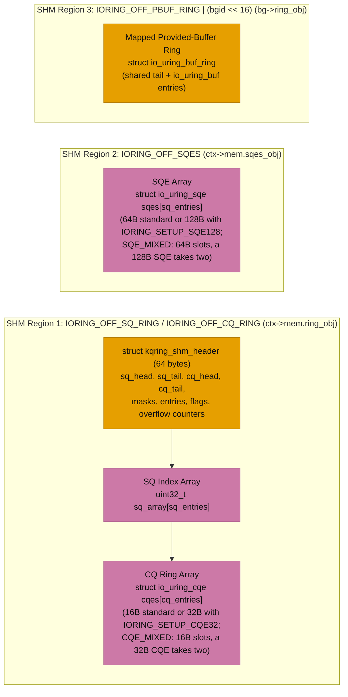

- **One header, one cache line:** [`struct kqring_shm_header`](kmod/kqring_var.h) holds every ring index, mask and flag in 64 bytes, checked by a `_Static_assert`. `io_uring_params` gives the program the offsets, so the layout is private to kqring.
- **`IORING_SETUP_NO_MMAP` and user-backed `PBUF_RING`s:** for `NO_MMAP`, the two ring regions are the caller's memory instead, at `cq_off.user_addr` (header, SQ array, CQEs) and `sq_off.user_addr` (SQEs). `kqring_pin_shm()` holds the pages (`vm_fault_quick_hold_pages()`), maps them at a KVA with `pmap_qenter()`, and (for `NO_MMAP` rings) sets the range `VM_INHERIT_SHARE`: after a `fork(2)`, copy-on-write would hand the parent new pages at its next write while the ring kept the old ones. The ring descriptor then can't be mmap'd. With `REGISTERED_FD_ONLY` the ring goes straight into the process's registered-ring table and `kqring_setup()` returns the slot; with `NO_SQARRAY` there is no SQ array and SQ entries index the SQEs directly. User-backed provided-buffer rings (registered without `IOU_PBUF_RING_MMAP`) also pin their pages into KVA via `kqring_pin_shm(..., share_on_fork=false)` so buffer selection reads `bg->ring_kva` directly without `copyin(9)` while keeping user heap/anonymous pages private across `fork(2)`; after a `fork(2)`, `kqring_bring_kva_ok()` sees `bg->cow_gen != ctx->cow_gen` and falls back to `bg->ring_uaddr`.
- **`IORING_REGISTER_RESIZE_RINGS`:** on a `DEFER_TASKRUN` ring `kqring_resize_rings()` allocates new regions (or pins the caller's new memory for `NO_MMAP`), copies the SQEs not yet consumed and the CQEs not yet reaped to the same positions, and swaps `ctx->mem` and the ring pointers under `ctx->mtx`. The issuer, which is the caller and holds `sq_sx`, is the only thread that reads SQEs or posts CQEs on such a ring, and every other thread looks at the rings only under `ctx->mtx`, so the old regions are freed at once. Mappings of them keep their pages until they are unmapped.
- **Overflow and `IORING_FEAT_NODROP`:** if `cq_tail - cq_head >= cq_entries`, completions are queued in `ctx->ocq` and `IORING_SQ_CQ_OVERFLOW` is set; `kqring_flush_overflow()` moves them into the CQ ring as userspace advances `cq_head`. From `KQRING_OCQ_BUSY` (16,384) queued CQEs on, enters submit nothing and fail with `EBUSY`, MSG_RING CQEs wait in `ctx->rcq` (senders get `EOVERFLOW` once it is full), and a multishot request whose next CQE would overflow ends with it instead, without `F_MORE`, as on Linux. What can still arrive is bounded by the live requests, so `KQRING_MAX_OVERFLOW` leaves room for all of it. Resource tag CQEs (`kqring_post_cqe_nodrop()`) are never dropped and are counted apart (`nocq_tags`), so they never use up the room kept for other CQEs: there is at most one per slot a call published with a tag (a registration that fails releases its slots without tags), and the register calls that release slots (`*_UPDATE`, `UNREGISTER_*`, `CLONE_BUFFERS`) fail with `EBUSY` from `KQRING_OCQ_BUSY` on, as submission does, so they can't be repeated to queue more. Should the ceiling still be reached, a CQE is dropped, counted in `cq_overflow`, and the next enter that reaps fails once with `EOVERFLOW`, standing in for Linux's `EBADR`, which FreeBSD lacks.
- **Ring memory accounting:** ring regions, `IOU_PBUF_RING_MMAP` rings, user-backed `PBUF_RING`s and `NO_MMAP` pages are charged to the creating user's real uid (`kqring_mem_charge()`), up to `kern.kqring.user_ring_mem` bytes over all their rings (default 1/16 of physical memory, 0 for no limit); past it setup and registration fail with `ENOMEM`. `NO_MMAP` and user-backed `PBUF_RING` pages, the user's own memory wired for the ring, also count in `vm.max_user_wired`.

---

## 3. Execution Model

`kqring` enforces a strict single-writer invariant for the Completion Queue (CQ), request lifecycle, and resource tables:

1. **Asynchronous contexts never write CQEs or mutate resource tables.** Socket upcalls, `callout` timer callbacks, `MSG_RING` senders, and in-process worker threads only enqueue work onto `ctx->taskwork_ops` (or `ctx->rcq` for `MSG_RING`), set `IORING_SQ_TASKRUN`, and wake the ring sleeper (`&ctx->wakeup_chan` / `&ctx->sqpoll_wait_chan` / the registered eventfd).
   - **Lazy wake-up**, as io_uring's for `DEFER_TASKRUN`: an enter waiting in `kqring_wait_cqes()` records how many CQEs it still needs (`ctx->cq_wait_nr`). A worker or bio completion of a plain `READ`/`WRITE` (`kqring_taskwork_add_lazy_locked()`) wakes it only once that many are queued (`ctx->tw_lazy`), so `min_complete` = N costs one wake-up rather than N. Everything else wakes it at once: linked or drained requests (the next one can only be issued once this one's taskwork runs), multishot and readiness ops, and any wait with another sleeper on the ring.
2. **All completions and table mutations run on the serialized issuer path:**
   - **`SINGLE_ISSUER | DEFER_TASKRUN`:** The owning thread (`ctx->owner_tid`) inside `kqring_enter(2)` (or `KQRING_IOC_ENTER`).
   - **Shared rings (no `SINGLE_ISSUER`):** any thread of the owner process (`ctx->shared`), one at a time under `sx_xlock(&ctx->sq_sx)`.
   - **No `DEFER_TASKRUN` (`ctx->taskrun_only`):** a `kqtask` kernel thread in the owner process also runs taskwork as it is queued, so completions appear without an enter, as Linux's task_work does; it takes `sq_sx` like an enter and wakes waiters after each batch.
   - **`IORING_SETUP_SQPOLL` mode:** Either the in-process `kqsqp` thread (`kqring_sqpoll_thread`) or an entering thread, mutually serialized by `sx_xlock(&ctx->sq_sx)`.
   - Workers resolve descriptors in the owner's table and copy to its memory, so a ring belongs to one process at a time. Another process holding a ring without `SINGLE_ISSUER` or `SQPOLL` that submits or registers takes it over when it can move (`kqring_ctx_takeover()`: nothing in flight, no registered or provided buffers, personalities, polls or extension state). Under `sq_sx` it moves the owner and sets `ctx->handover_td` and `ctx->detaching`. The old owner's `kqtask` thread and poller exit, as they do on `closing`. Its worker pool is closed, and the ring gets a new pool and `kqtask` thread in the new process. Enters and registrations re-check ownership once they hold `sq_sx`, so a thread that passed the check before the move gets `EEXIST`. `kqring_run_taskwork()` and `kqring_run_checks()` do nothing outside the owner's process. Another process may also wait on such a ring (a *foreign* wait in `kqring_wait_cqes()`): it only sleeps on the CQ, and the owner's `kqtask` thread posts the completions. See [docs/cross-process-rings.md](docs/cross-process-rings.md).

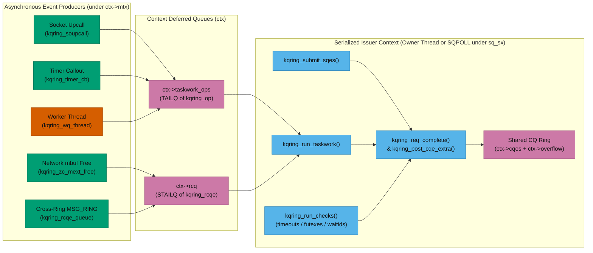

### 3a. Kernel Threads

Every thread below is a kernel thread inside the ring owner's process, so it sees the owner's address space and is stopped, single-threaded and killed along with it. A ring uses none of them until it needs one.

| Thread | How many | Created | Does |
|---|---|---|---|
| `kqwqb` | up to 4 per CPU, per pool | first bounded request that has to wait | Regular file and device I/O |
| `kqwqu` | up to `KQRING_WQ_MAX_WORKERS` per pool | first unbounded request that has to wait | Pipes, FIFOs, path operations, `SPLICE`, `WAITID`, readiness waits |
| `kqsqp` | one per `SQPOLL` ring | ring setup | Reads the SQ and runs taskwork in place of an enter |
| `kqtask` | one per ring without `DEFER_TASKRUN` | ring setup | Runs taskwork, so that completions appear without an enter |
| `kqpoll` | one per ring | first non-socket poll, kevent request or bridge | Waits on the ring's kqueue and turns events into taskwork |

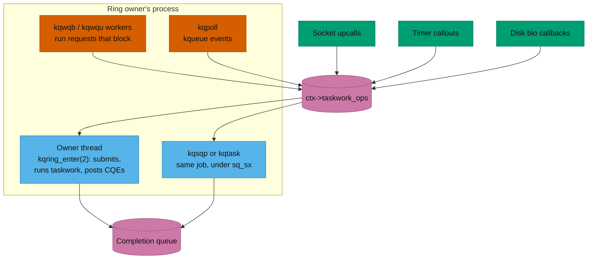

---

## 4. Request Lifecycle & State Machine

Every submitted SQE is represented by a `struct kqring_op` allocated in `kqring_submit_sqes()`.

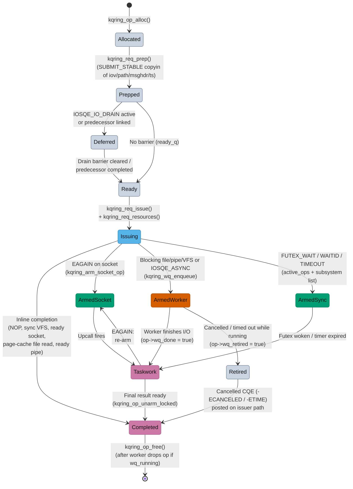

A socket request goes back to `ArmedSocket` on `EAGAIN`: after a spurious wakeup, or when a multishot burst continues, which posts an intermediate CQE with `IORING_CQE_F_MORE`. The upcall queues it with `kqring_taskwork_add_locked()`.

### Key Invariants
- **`IORING_FEAT_SUBMIT_STABLE`:** `kqring_req_prep()` copies all indirect user arguments (`iovec` arrays, `msghdr`, `sockaddr`, file paths, `open_how`, xattr names/values, futex vectors, and `timespec`s) into kernel memory (`op->args`, charged against `ctx->args_bytes <= KQRING_MAX_ARG_BYTES`) at submission time. Userspace can reuse or free argument memory immediately after `kqring_submit_sqes()` consumes the SQE.
- **Stack-bounded chain execution:** Linked requests (`IOSQE_IO_LINK`, `IOSQE_IO_HARDLINK`) and `IOSQE_IO_DRAIN` barriers are queued on `ctx->ready_q` and `ctx->defer_q` and driven iteratively by `kqring_flush_ready()`, never by recursive calls.

### Where a Request Goes

`kqring_req_issue()` picks the cheapest path that won't block the submitting thread:

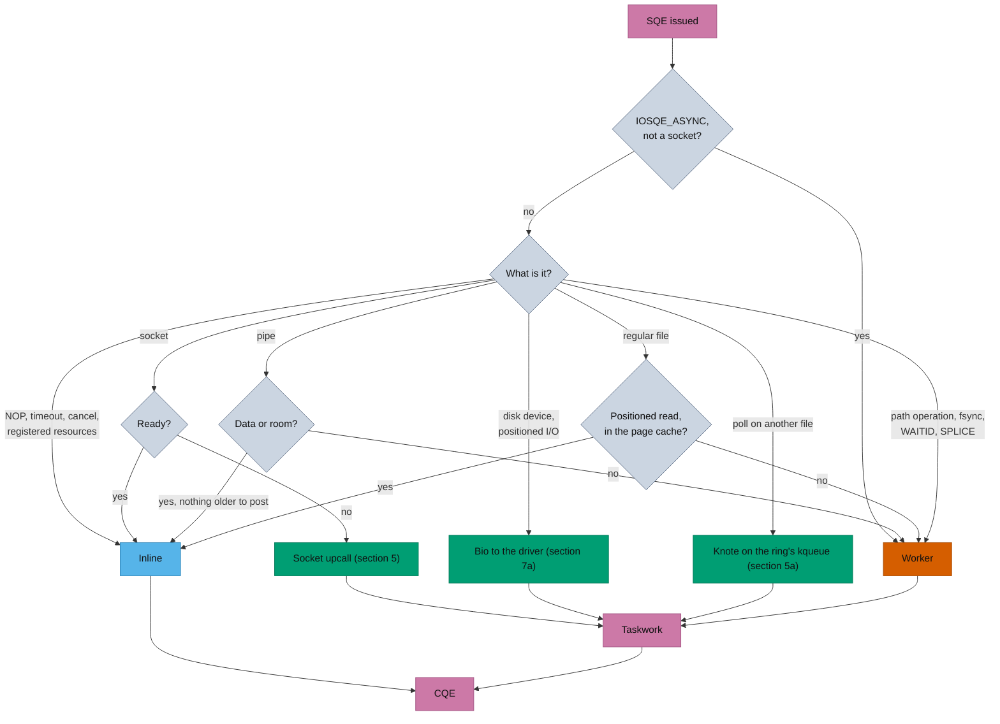

Each path costs more than the one before it, and these are measured on an i5-8250U ([BENCHMARK.MD](BENCHMARK.MD)):

---

## 5. Socket Fast Path & Upcall Arming (`kqring_sock.c`)

Socket operations (`RECV`, `SEND`, `RECVMSG`, `SENDMSG`, `SEND_ZC`, `SENDMSG_ZC`, `ACCEPT`, `CONNECT`, `POLL_ADD`, and socket `READ`/`WRITE`) follow an **inline-first, upcall-fallback** pipeline:

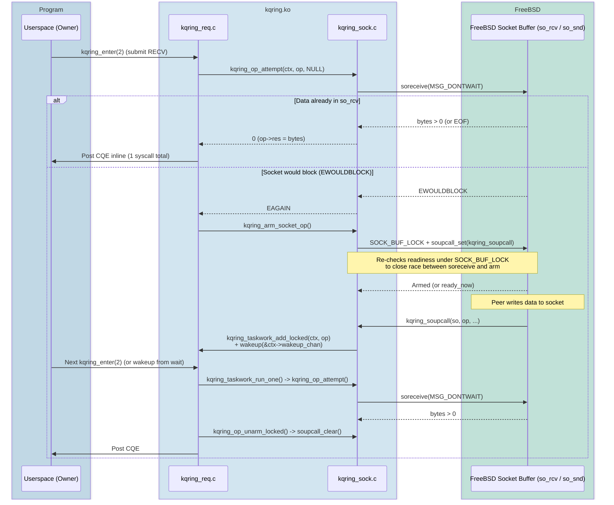

- **Many waiters per direction and one-shot detach:** FreeBSD sockets provide a single upcall slot per sockbuf (`so_rcv`, `so_snd`), and one for a listener's queue. kqring installs a waiter list (`struct kqring_sowatch`, cached per ring in `ctx->sw_cache`) as the upcall argument instead of an op. Each op that arms in that direction joins the list, from any ring. The buffer's lock (the listen lock for a listener) protects the list, and the last op to leave clears the upcall and frees it. The upcall queues every waiter as taskwork under `ctx->mtx`; for one-shot single-direction sockbuf ops (`op->oneshot_sb`), `kqring_soupcall()` also detaches the op from `sw->ops` and clears `soupcall_clear()` (if `sw->ops` is now empty) inside that same `ctx->mtx` critical section while `SOCK_BUF_LOCK` is already held, saving the owner thread from re-acquiring `SOCK_BUF_LOCK` when completing the op. An op that then finds nothing left (`EAGAIN`), because another waiter took the data or a `MSG_WAITALL` read was only partially satisfied, re-arms cleanly via `kqring_arm_socket_op()`. As in io_uring, any number of `RECV`, `POLL_ADD` or `ACCEPT` requests can wait on one socket. If a slot holds an upcall that kqring did not install, arming still fails with `-EBUSY` rather than overwriting it. One difference from Linux: a `POLL_ADD` re-checks readiness when it runs. A poll queued behind a `RECV` that consumes the data stays armed, where Linux would report the wakeup's mask.
- **Socket references and the vnet:** an armed op holds `soref()` (`op->so_soref`) when `op->sock_fp` is not already held, and when the descriptor is closed first, the op holds the last reference. Dropping it runs the protocol's detach (`tcp_discardcb()` counts TCP states per vnet). Ring teardown and taskwork run with no current vnet, so `kqring_sorele()` sets the socket's vnet around `sorele()`, as `soclose()` does.
- **The socket's file is held across retries:** a `RECV`, `RECVMSG`, `SEND` or `SENDMSG` attempt that would block keeps the file reference it looked up (`op->sock_fp`, taken with the operation's own Capsicum rights). Arming and every later attempt use it instead of looking up `sqe->fd` again, and `kqring_op_free()` releases it. As with io_uring's `req->file`, closing the descriptor or `dup2(2)` over it no longer affects the request: it completes from its original socket, or on cancellation.
- **`listen(2)` race protection:** On FreeBSD 15, `solisten_proto()` converts a socket's `so_rcv`/`so_snd` union into listen queues under both sockbuf locks. Every sockbuf lock acquisition in `kqring_sock.c` re-checks `SOLISTENING(so)` before touching `so_rcv` or `so_snd`.

### 5a. Non-Socket `POLL_ADD` (`kqring_kpoll.c`)

Pipes, FIFOs, eventfds, ttys, kqueues, ring descriptors and devices with a `d_kqfilter` have no upcall slot, so a `POLL_ADD` on them becomes kqueue knotes:

- **One kqueue per process context, with no descriptor.** A knote names a descriptor of one process's table, so each process using the ring (`struct kqring_tctx`) has its own. On that process's first such poll, `kern_kqueue()` creates a kqueue on its descriptor table; kqring takes a file reference (`t->kp_fp`) and closes the descriptor at once. A `kqpoll` kernel thread in that process sleeps on it (waking every 50 ms to notice suspension and teardown). It sleeps on the kqueue directly (`kqring_kp_wait()`), as `kqueue_scan()` does, rather than inside `kern_kevent_fp()`, so that it holds no event while it sleeps.
- **Each request is one or two knotes** (`EVFILT_READ` and/or `EVFILT_WRITE` on `sqe->fd`), with `udata` = a per-ring request id. A single-shot poll uses `EV_ONESHOT`; a multishot one `EV_CLEAR`. The knote catches every wakeup of the file, so any number of polls cost no threads.
- **Delivery is taskwork.** The poller only records the events (`op->kp_revents`, `op->kp_nev`) under `ctx->mtx` and queues the request; `kqring_kpoll_deliver()` posts one CQE per event for a multishot poll, ending it instead when the CQ would overflow.
- **Lookups are hashed:** armed polls by descriptor (`ctx->kp_ops[]`, for events and the check that a context's kqueue gets one knote per descriptor and filter) and every armed `POLL_ADD` by `user_data` (`ctx->poll_hash[]`, for `POLL_REMOVE`).
- **Fallbacks:** a poll on a fixed file (no descriptor to register), on a file without a kqfilter, or a second one on the same descriptor and filter waits on a worker (`kqring_wq_poll_wait()`).
- **Lifetime:** the kqueue lives on its process's descriptor table, which `exit1()` frees once the process's threads are gone, and a ring can outlive it (a child inherited the descriptor). So the poller closes the kqueue itself when it leaves because the process exits or execs, and the context's exit task closes it if the poller never ran; ring teardown closes it otherwise. Knotes are deleted (`EV_DELETE`) only from their own process; elsewhere they go with the kqueue.
- **Wakeups are counted as they happen.** `kqueue_scan()` asks the filter again before reporting a knote and drops the event if the file is no longer ready, so a pipe written and drained before the poller looks would post nothing. A multishot poll's knotes therefore get a copy of their `filterops` whose `f_event` counts wakeups in the knote's `kevent` `ext[2]`/`ext[3]` (which filters leave alone). A wakeup is `f_event` called from `knote()`, which holds the kq lock; the scan calls it without. The scan reports the knote while wakeups are unreported, and the poller posts one CQE per wakeup. A pipe's knotes share one list and every read or write asks them all, so only a wakeup that makes the file ready or readier (more data, more room, EOF) counts, as Linux wakes only the pollers a change is meant for. The swap is made under the kq lock on a knote not in flux: every caller of `f_event` and `f_detach` holds that lock or has the knote in flux.
- **Polls on another ring complete within the waking enter.** An enter that woke its ring's pollers (a CQE made the ring readable, or its eventfd was signalled: `ctx->woke_pollers`) ends with `kqring_kpoll_run()`. It takes the events from the kqueues of the process's rings, and on a ring without `DEFER_TASKRUN` that the thread may enter runs its taskwork under `ctx->sq_sx`, so the poll's CQE is posted before the enter returns, as io_uring's poll `task_work` would be. `kqueue_scan()` takes an event off the kqueue before anyone can record it, so an event in that moment is in neither place. Taking and recording are therefore one step under the context's `kp_sx` (`kqring_kp_take()`), for the poller and enters alike: an enter that finds the kqueue empty has waited for whatever the poller took. It also waits for `sq_sx` rather than try it, as the holder may be the `kqtask` thread part way through posting that CQE. On a ring with `IORING_SETUP_TASKRUN_FLAG`, the counting filter also sets `IORING_SQ_TASKRUN` as the wakeup happens (`kqring_kp_kick()`), and an enter with `IORING_ENTER_GETEVENTS` takes the kicked events first, so a program that peeks at the CQ after firing a poll enters and finds the CQE. The filter can't take `ctx->mtx` there, so `kqring_resize_rings()`, having replaced `ctx->shm`, takes each context's kqueue lock in turn (`kqring_kp_shm_barrier()`) before it frees the old header. A kick marks its context (`t->kp_kick`), and only an enter of that process takes the kicked events. Debug kernels have `kern.kqring.kp_test_gap_us`, which holds the poller in that moment so that `test_poll_before_return` meets it every round. It runs inside the enter system call, under the module's unload accounting; a return-to-user AST would need a handler that `ast_deregister()` cannot drain. A poller thread and `kqring_kpoll_run()` may then record events of one knote out of order: an event whose wakeup count is older than `kp_seen` is ignored, since the later one counted its wakeups.
- **Any other wakeup wakes a waiting enter directly.** The counting `f_event`, called from `knote()` in the waker (a `write(2)` to a polled pipe from another process, say), finds the ring in the knote's `ext[1]` (set when the `filterops` are swapped; the ring closes its kqueue, and so its knotes, before it is freed). It sets `ctx->kp_kick` and, if an enter is asleep in `kqring_wait_cqes()` (`ctx->cq_sleepers`), wakes it. That enter takes the kqueue's events itself (`kqring_kpoll_kicked()`, a zero-timeout scan as `kqring_kpoll_run()` makes) and runs their taskwork, one hand-off instead of two. Only a flag and `wakeup()`: the file's lock is held there, and `ctx->mtx` must not nest inside it. A wakeup that races the enter going to sleep, and any wakeup while no enter waits (or on an `SQPOLL` ring), is still collected by the poller thread.
- **Differences from Linux:** with no enter waiting, such a wakeup's CQE appears when the poller thread collects it, a moment later, rather than before the waker's system call returns. A signal arriving while `kqring_kpoll_run()` waits for `sq_sx` has the same effect on a poll on another ring: the `kqtask` thread or the next enter posts the CQE.

---

## 6. Zero-Copy Transmit (`SEND_ZC` / `SENDMSG_ZC`)

`kqring` implements true zero-copy transmit for connected `AF_UNIX` and `AF_INET`/`AF_INET6` TCP stream sockets on transfers of at least `PAGE_SIZE` (4 KiB; on `AF_UNIX`, an unregistered buffer must reach `kern.kqring.zc_local_min_len`, 32 KiB by default, below which copying is cheaper than pinning per send), supporting both **Phase A** (`IORING_RECVSEND_FIXED_BUF` registered buffers) and **Phase B** (unregistered user buffers and multi-segment scatter/gather `SENDMSG_ZC`).

A send sends what the socket has room for. With `MSG_WAITALL` on a stream socket, a short one waits for room and goes on from where it stopped, zero-copy again, as io_uring retries it. The request keeps its one `kqring_zc_notif` across the attempts: each attempt pins its range into a temporary holder, hands those buffers to the notification (`kqring_zc_notif_merge()`), and adds its mbufs' references, so the single `IORING_CQE_F_NOTIF` comes once every attempt's pages are released. A remainder below a page, or one that can't be pinned, is copied, and the notification then reports `IORING_NOTIF_USAGE_ZC_COPIED` if `IORING_SEND_ZC_REPORT_USAGE` asked, as io_uring's does when any part was copied. Since the CQE always carries `IORING_CQE_F_MORE`, the notification is posted whatever the result, a cancel included.

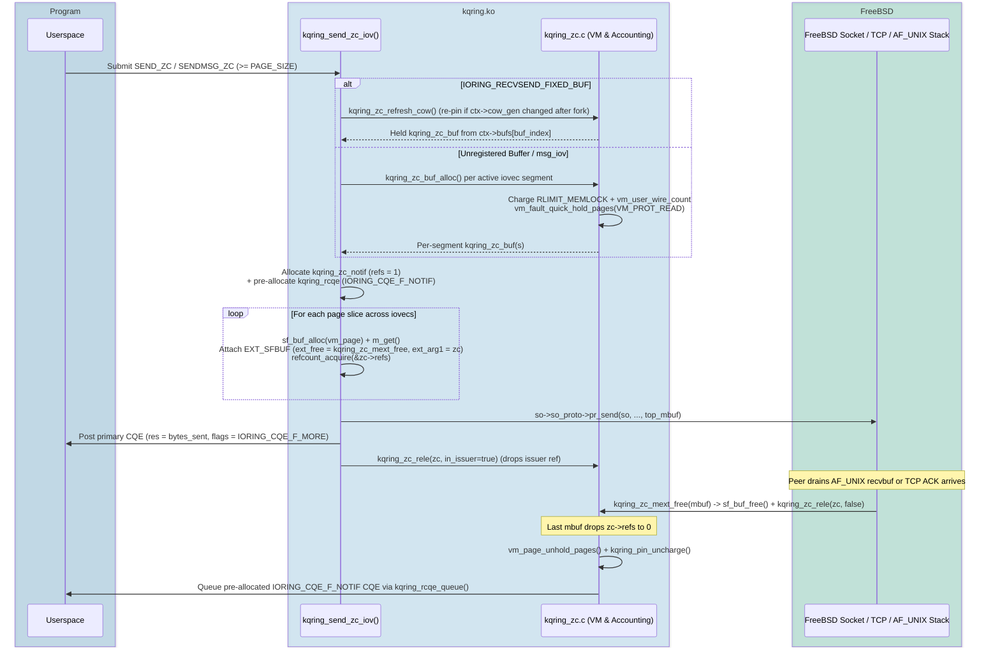

### Zero-Copy Ownership & Accounting Model

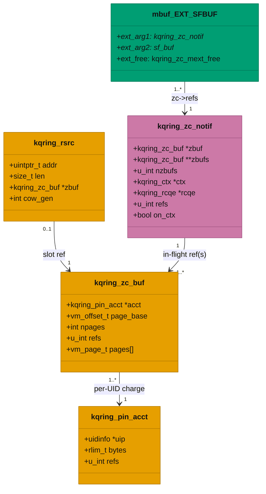

- **Decoupled page lifetime:** `RLIMIT_MEMLOCK` and `vm_user_wire_count` charges live on `kqring_zc_buf`, not on the ring slot. Unregistering a buffer or closing the ring while zero-copy mbufs are still unread in a peer socket or awaiting TCP ACK keeps the pages held and charged until the last `EXT_SFBUF` mbuf is freed.
- **Copy-on-write safety (`fork`):** `kqring_proc_fork` increments `ctx->cow_gen` on every ring in the parent process. Before a registered buffer is used for `SEND_ZC` or `SENDMSG_ZC`, `kqring_zc_refresh_cow()` compares `r->cow_gen` with `ctx->cow_gen` and re-pins the post-fork physical pages (discounting the old buffer's pages from the `RLIMIT_MEMLOCK` check if no unread mbuf holds an extra reference to the old `kqring_zc_buf`).
- **Module unload barrier:** Each active `kqring_zc_notif` increments `kqring_live_zc` via `kqring_zc_hold()`. `MOD_QUIESCE` rejects `kldunload` with `EBUSY` while `kqring_live_zc > 0`, and `MOD_UNLOAD` sets `kqring_unloading = true` and drains `kqring_live_zc` so no `EXT_SFBUF` mbuf can ever invoke `kqring_zc_mext_free` after `kqring.ko` is unmapped.

---

## 7. In-Process Worker Pool & Detached Cancellation (`kqring_wq.c`)

Before a non-socket `READ`/`WRITE` is handed to a worker, `kqring_file_rw_inline()` tries to complete it on the issuer when that cannot block, as Linux `io_uring` tries `IOCB_NOWAIT` before punting to `io-wq`:

- **Regular files:** a positioned read is served from the page cache through `VOP_READ_PGCACHE` (UFS, tmpfs), the path `vn_read()` tries first. It grabs resident pages without sleeping and returns `EJUSTRETURN` on a miss. As `vn_io_fault()` does for `read(2)`, it holds a read range lock (taken with `vn_rangelock_tryrlock()`, never waiting) and copies out with page faults disabled, so a destination that would fault (unmapped, or mapped from the same file) cannot deadlock against the busied file pages. A miss, a contended range, a copy that would fault, or a partial copy short of end of file leaves the request untouched for the worker, which redoes it in full.
- **Pipes:** a `READ` on a pipe that has data, or a `WRITE` to one with room, runs inline, blocking or not; one that would wait goes to a worker, even on an `O_NONBLOCK` pipe (io_uring polls rather than fail with `EAGAIN`). The issuer never waits on a pipe: `pipe_read()` and `pipe_write()` look at the file only for `f_data` and `f_flag`, so kqring calls them on a `struct file` of its own on the stack, sharing the pipe, with `FNONBLOCK` set (`kqring_pipe_rw_nowait()`). If another reader drained the pipe since the check, the read goes to a worker unchanged. A write that fills the pipe keeps what it wrote in `op->done_io`, and a worker writes the rest, as the blocking `write(2)` would.

Blocking operations on regular files, pipes, FIFOs, devices, VFS paths, `WAITID`, non-socket `POLL_ADD` that cannot be a knote (section 5a), and any SQE with `IOSQE_ASYNC` execute on an in-process kernel worker pool (`struct kqring_wq`, `IORING_FEAT_NATIVE_WORKERS`):

- **Two sub-pools per `kqring_wq`:**
  - `IO_WQ_BOUND` (default cap 4 per CPU): regular file/device I/O.
  - `IO_WQ_UNBOUND` (default cap `KQRING_WQ_MAX_WORKERS`): pipes, FIFOs, VFS metadata/path operations, `SPLICE`/`TEE`, `WAITID`, and non-socket readiness waits.
- **Address-space sharing:** Workers are created with `kthread_add(..., wq->proc, ...)` inside the ring owner's `struct proc`, so `copyin`/`copyout`/`uiomove` and credential switching (`kqring_cred_enter`) work directly on user addresses without cross-process VM mapping.
- **Bounded adaptive spinning:** At most one idle worker per sub-pool spins briefly with `cpu_spinwait()` (`wq->spinning[type]`) before entering `msleep()`; the rest sleep, since every idle worker spinning sent them all at `wq->mtx` for each new op. It spins only with a CPU to spare (`sched_load() < mp_ncpus`): with every CPU taken, a spinner only keeps the thread with the next op, or its issuer, from running. Without this rule 8 rings on 4 cores ran at a quarter of the speed of 4. Enqueue wakes a sleeping worker whenever `wq->spinning[type] < wq->pending[type]`.
- **The `SQPOLL` thread polls while active.** For `sq_thread_idle` (default 1 s) after its last work, `kqring_sqpoll_thread()` spins with `cpu_spinwait()` on the SQ tail, `ctx->taskwork_ops` and `ctx->rcq`, without `ctx->mtx`, in 50 µs slices, as io_uring's SQPOLL thread does; a stop, exit or close ends the spin at once. Sleeping there instead cost a wake-up per request to submit it and another to complete it. Past `sq_thread_idle` it sets `IORING_SQ_NEED_WAKEUP` and sleeps. A `kqtask` thread (no `DEFER_TASKRUN`) never spins.
- **Synchronous hand-off:** `kqring_wq_enqueue()` waits (`kqwqsy`) for a non-blocking op's worker and posts its CQE itself, which saves a taskwork round trip for a lone request. A wake-up across CPUs costs about 2 µs in each direction, so both sides spin first.
- **What needs no order runs in parallel.** A read, or an `O_DIRECT` write at its own offset (`kqring_op_wq_unordered()`), is left to its worker: the issuer spins for it only for a program in lockstep (one that has taken every CQE, with a CPU to spare, `kqring_wq_spin_locked()`) and stops waiting after the spin. It skips the wait altogether when more SQEs follow in the same submission (`ctx->submit_more`) or another op is on its sub-pool's workers, so a batch runs on several workers at once. Workers post those CQEs (`op->wq_blocking`). Other ops always wait, which keeps writes to one file in submission order, as io-wq's per-inode hashing does, and buffered writes therefore run one at a time.
- **Non-blocking cancellation & detached close:**
  - When an armed worker request is cancelled (`ASYNC_CANCEL`, `POLL_REMOVE`, `LINK_TIMEOUT`, or ring close), `kqring` doesn't block the issuer waiting for the worker thread.
  - Instead, the op is moved to `ctx->retired_ops` (`op->wq_retired = true`), `kqring_wq_abort_td()` sends `sleepq_abort(wtd, EINTR)` to interrupt any interruptible sleep, and `ctx->wq_abort_callout` re-sends the interrupt every 1 ms until the worker exits its syscall and releases the op. Its `-ECANCELED` (or `-ETIME`) CQE is posted via taskwork only once the worker has returned (`wq_complete_pending`), so the buffer is free when the CQE appears.
  - `IORING_REGISTER_SYNC_CANCEL` does wait: `kqring_cancel_wait()` runs taskwork and sleeps until no matched request is still retired or running as disk I/O, or `sc.timeout` passes (`ETIME`; both fields -1 for no timeout), as Linux's synchronous cancel does.
  - On `close(ring_fd)`, `kqring_close()` cancels everything (`kqring_ctx_cancel_all()`), and final `kqring_ctx` / `kqring_wq` destruction waits until the last running worker drops its `ctx->refs` reference (`kqring_ctx_rele()`). If a stop interrupts that, teardown finishes on the `kqteardown` taskqueue, so a process stopped under `truss(1)` or a debugger can't deadlock in close.

### 7a. Disk Devices: Straight to the Driver

A positioned `READ` or `WRITE` on a disk device doesn't need a worker. `kqring_file_bio()` builds an unmapped bio over the held user pages and sends it to the driver, as `aio(4)` does. `kqring_bio_done()` runs when the last bio finishes, in whatever thread the driver uses, and queues the request as taskwork.

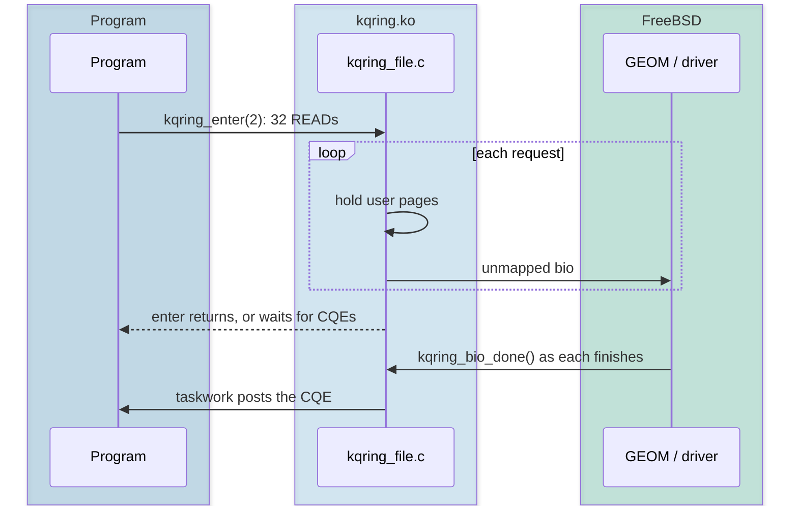

All 32 reach the driver at once, which a thread calling `pread(2)` can't do. Bios can't be cancelled in flight, and ring teardown waits for them (`ctx->nbio`). FreeBSD filesystems have no asynchronous entry point, and sending bios under one would bypass its allocation and locking, so a file on a filesystem always takes the worker path.

### 7b. Reads of a Pipe Stay in Data Order

Several `READ`s waiting on one pipe each have a worker. A worker that read first must post first, or the CQEs wouldn't match the order of the data. Only the issuer posts, in the order of `taskwork_ops`, so what matters is that the read and the queueing are one step:

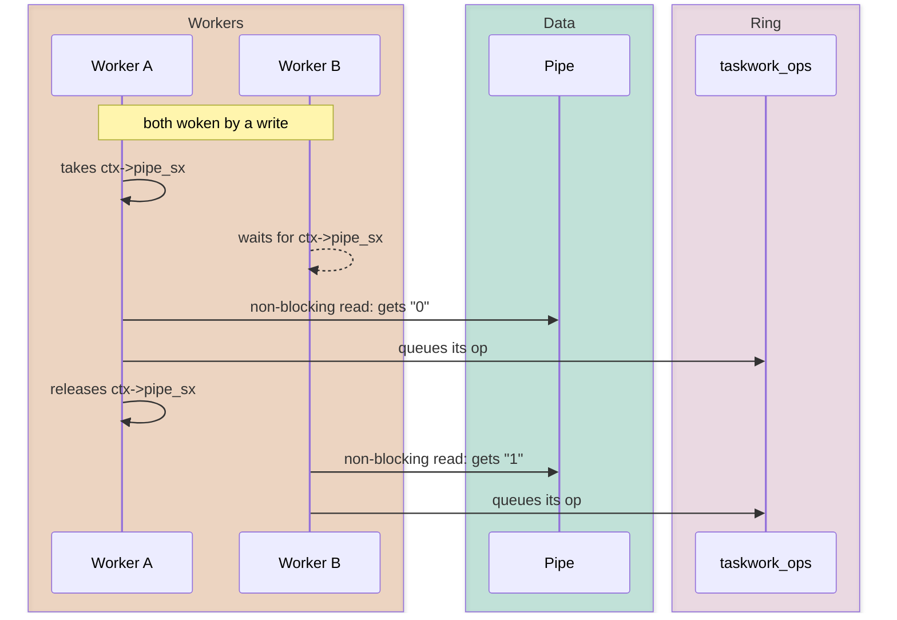

The worker waits for data before it takes the lock, and reads without blocking while it holds it, so a slow writer can't stall the others. An issuer reading a ready pipe inline only tries the lock, and leaves the read to a worker if the lock is held or older completions are still queued (except `RWF_NOWAIT`, which would turn that into a failure). The issuer doing all the reads, as Linux's task_work does, would be simpler, but a thread blocked writing to its own pipe could then never drain it. Named FIFOs block inside `fo_read()` and aren't covered.

A FIFO's reads take the same path: its file has `pipeops` and a `struct pipe`, and reads it as a pipe, end of file included. Its writes don't, because a FIFO has no `pipe_peer`.

---

## 8. Locking Hierarchy & Concurrency Invariants

To prevent deadlocks across synchronous submission, socket upcalls, callouts, worker threads, and process lifecycle hooks, `kqring` enforces a strict lock acquisition order:

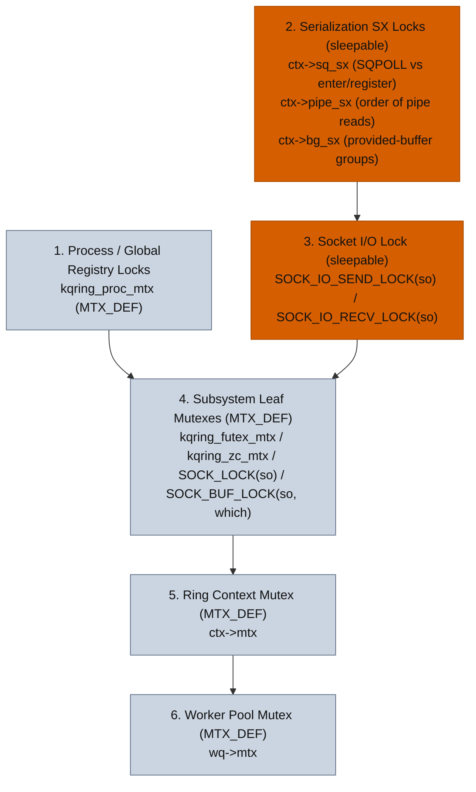

| Lock | Type | Protects | Ordering Rules |
|---|---|---|---|
| `kqring_proc_mtx` | `MTX_DEF` | `kqring_proc_hash`, `kqring_ctx_list`, `kqring_live_workers`, `kqring_live_zc`, `kqring_nfiles`, `kqring_unloading` | Acquired before `ctx->mtx` or `wq->mtx` during process `exit`/`exec`/`fork` and module unload. |
| `ctx->sq_sx` | `struct sx` | Serializes `kqring_sqpoll_thread`, enter submission/taskwork, register, setup, and teardown (`kqring_ctx_cancel_all`) | Sleepable outer lock; never held by upcalls, callouts, or workers. Enter skips it when the ring has no SQPOLL thread and its worker pool belongs to the caller's process: then nothing else can run that code concurrently (close waits for the enter's file reference, and the owner's own exit or exec waits for the owner to leave the kernel). |
| `ctx->pipe_sx` | `struct sx` | A worker's read of a pipe, from the read until the op is on `taskwork_ops`, so CQEs follow the order of the data | The read doesn't wait for the pipe while holding it. The issuer only tries it, and leaves the read to a worker if it is held or taskwork is queued. Outside `ctx->bg_sx` and `ctx->mtx`. |
| `ctx->bg_sx` | `struct sx` | `ctx->bgroups` hash, `PROVIDED_BUFFERS`, `PBUF_RING` selection/commit | Sleepable lock; nests inside `ctx->sq_sx` and outside `SOCK_BUF_LOCK` / `ctx->mtx`. |
| `SOCK_IO_SEND_LOCK` | `struct sx` | Serializes socket send operations (`kqring_send_zc_iov`, `sosend`) | Acquired before `SOCK_BUF_LOCK`, `kqring_zc_mtx`, and `ctx->mtx`. |
| `SOCK_BUF_LOCK` | `MTX_DEF` | Socket buffer state (`so_rcv` / `so_snd`) and `sb_upcall` | Acquired **before** `ctx->mtx` (matching the order in which `sowakeup` -> `kqring_soupcall` enters `kqring`). |
| `kqring_futex_mtx` | `MTX_DEF` | Global `kqring_futex_hash` table | Acquired **before** `ctx->mtx`. |
| `kqring_zc_mtx` | `MTX_DEF` | `kqring_pin_list` and `zc_notif->ctx` detachment | Acquired **before** `ctx->mtx`. |
| `ctx->mtx` | `MTX_DEF` | `taskwork_ops`, `active_ops`, `retired_ops`, `rcq`, `zc_pending`, `wakeup_chan`, the eventfd | Leaf lock relative to socket/futex/ZC locks; only `wq->mtx` may nest inside `ctx->mtx`. |
| `wq->mtx` | `MTX_DEF` | Worker pool queues (`ops[]`), thread lists, worker counts, `wq->refs` | Innermost mutex; never acquires `ctx->mtx` while held. |

---

## 9. Process Lifecycle & Security Boundaries

- **Ring files cannot be passed over UNIX sockets.** `kqring_fileops` has no `DFLAG_PASSABLE`, so `SCM_RIGHTS` fails with `EOPNOTSUPP` (Linux 6.7 and later refuse io_uring files the same way). A ring can therefore never be in flight on a socket held in its own fixed-file table. It sets `DFLAG_FORK` instead, and `kqring_fork()` shares the same open file with a forked child, as an ordinary descriptor would be.
- **Module unload** fails with `EBUSY` while any ring file is open (`kqring_nfiles`): their file operations cannot be revoked as devfs revokes a cdev's. Once `kqring_unloading` is set, no ring can be opened.
- **System call drain at unload.** `kqring_enter(2)` is registered `SY_THR_STATIC` (`kern_syscall_register()` sets it in the same store that makes the slot present, so no call is ever counted by the kernel and then not) and counted per CPU (`kqring_sys_busy`), so the kernel's own drain doesn't cover it. After deregistering the calls and waiting for the per-CPU counts, `kqring_sys_drain_threads()` covers the instructions before the count and after it: every thread whose current system call (`td_sa.code`) is one of kqring's gets `TDA_AST` scheduled, and unload waits until each has cleared it in `ast()` on its way back to user space, or is gone. Only `ast_handler()` clears `td_ast`, and a thread's `td_sa.code` stays that call until it returns to user space, so no thread can still be in the module's code. A thread that doesn't get there within 10 s (a stopped process) makes the unload fail with `EBUSY`, and the calls are registered again.
- **Process exit (`kqring_proc_exit`):** Releases `ctx->files` and `ctx->bufs` and stops workers/SQPOLL for every ring the exiting process owns, as a second line of defence against reference cycles through the fixed-file table. A ring another process could take over (no `SINGLE_ISSUER` or `SQPOLL`) is released rather than closed (`kqring_ctx_release()`): the same cancel path runs with `ctx->release` set instead of `ctx->closing`, drops the worker pool (`ctx->wq = NULL`), and leaves the ring unowned and open for the processes that still hold it. A close that arrives meanwhile finishes the teardown as a close.
- **Process `execve(2)` (`kqring_proc_exec`):** Marks all rings owned by the process as `ctx->closing = true`, stops `SQPOLL` and workers, disarms all in-flight operations, and frees fixed resource tables so a new executable image cannot inherit active asynchronous kernel operations or pre-execve credentials.
- **Process `fork(2)` (`kqring_proc_fork`):** Increments `ctx->cow_gen` on all rings in the parent process so any registered buffer (`IORING_RECVSEND_FIXED_BUF`) refreshes its held physical pages on the next zero-copy send after copy-on-write mappings are established.
- **Capsicum (`CAP_RIGHTS` & `IN_CAPABILITY_MODE`):**
  - Fixed-file slots snapshot the `struct filecaps` of the descriptor at registration/install time and validate every operation against those rights.
  - Direct descriptors created via `OPENAT`/`OPENAT2` inherit the directory descriptor's Capsicum rights.
  - Personalities registered prior to `cap_enter(2)` are rejected with `-ECAPMODE` once the process enters capability mode, preventing sandbox escape via `sqe->personality`.

---

## 10. kqring Extensions

kqring adds operations io_uring doesn't have, and keeps them from ever colliding with a number Linux assigns later. A ring is plain io_uring until the program calls the `KQRING_IOC_EXT_SETUP` ioctl (`kqring_ext_setup()`). The ring then has one *escape opcode*, 0xFF by default and never an opcode this kernel implements, and `sqe->ioprio` selects the operation. The interface is in [docs/event-chains-spec.md](docs/event-chains-spec.md) and [`include/sys/kqring.h`](include/sys/kqring.h).

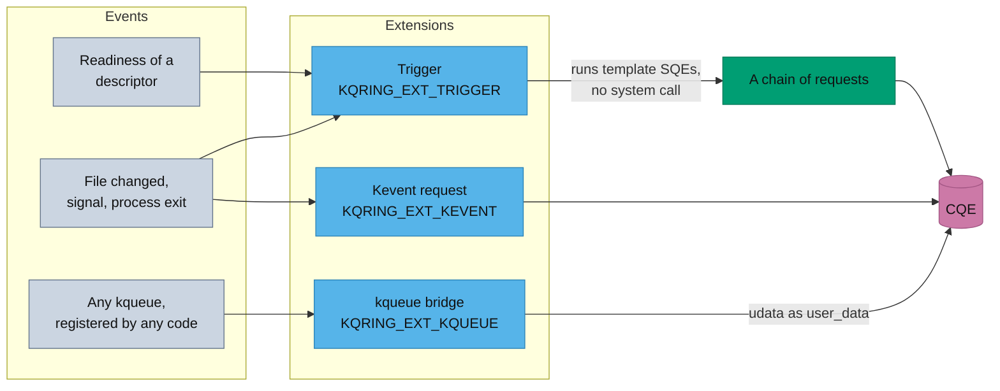

### 10a. Event-Driven Chains (`kqring_trig.c`)

In io_uring, linked requests run once. A **trigger** runs the up to 8 template SQEs linked after it as a new chain each time an event fires, with no system call per event.

- **A trigger waits on an internal request, its *waiter*:** a `POLL_ADD`, or a kevent request for `KQRING_TRIG_SRC_KEVENT`. The waiter's results come to `kqring_trig_waiter_event()` instead of the CQ.
- **Each event starts a *run*** (`kqring_trig_run()`), queued as a submission would be. `SERIAL` triggers wait with a one-shot poll and re-arm when their run is done; `CONCURRENT` ones keep a multishot poll armed and start a run per event, up to `max_inflight`.
- **Everything runs on the issuer,** like completions. A trigger is referenced by `ctx->triggers` until its final CQE, by its waiter, by each run, and while on `ctx->trig_work`. Work that would issue requests is done from `kqring_flush_ready()` through `ctx->trig_work`, never from inside a completion or `kqring_op_free()`.
- **A busy event can't hold an enter for ever.** After `KQRING_TRIG_BURST` firings in a row, a `SERIAL` re-arm goes through taskwork.
- **Steps pass results along** (`kqring_trun_step()`): `KQRING_STEP_LEN_FROM_PREV` sets a step's length from the bytes the step before moved, `KQRING_STEP_STOP_ON_ZERO` ends the trigger at end of file, and `KQRING_STEP_BUF_FROM_PREV` passes the provided buffer the step before filled, and gives it back to its group when done.

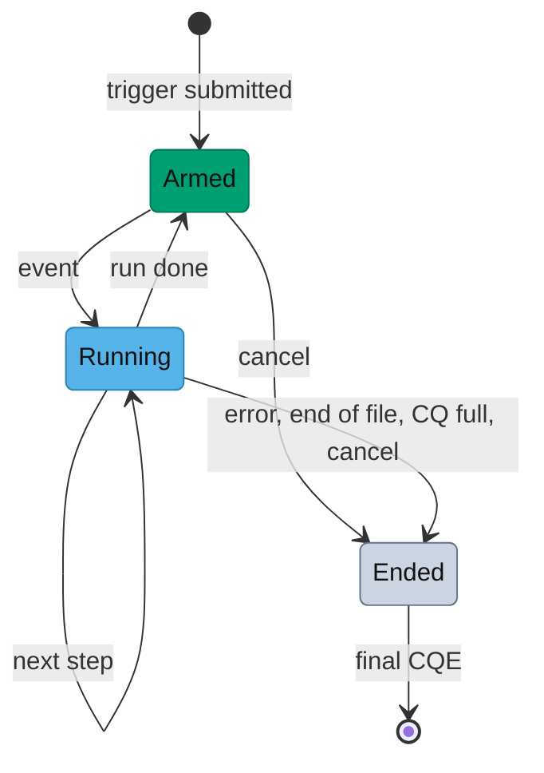

### 10b. Kevent Requests (`kqring_kpoll.c`)

A kevent request waits for an event io_uring has no request for: `EVFILT_VNODE` (a file or directory changed), `EVFILT_SIGNAL`, `EVFILT_PROC` (any process, not only a child), and `EVFILT_READ` / `EVFILT_WRITE` with byte counts. `kqring_kev_issue()` registers it on the ring's own kqueue (section 5a), and `kqring_kev_deliver()` posts its CQEs, one-shot or multishot.

### 10c. The kqueue Bridge (`kqring_kpoll.c`)

The bridge attaches an existing kqueue to a ring (`kqring_kq_take()`). Its events, registered by any code such as libevent or libuv, arrive as CQEs with `user_data` set to the event's `udata`, so a program can move to kqring one part at a time, with one wait for both. Each event is taken as `kevent(2)` would take it, so `EV_CLEAR`, `EV_ONESHOT` and `EV_DISPATCH` keep their meaning. If the CQ fills, the request ends with `-EOVERFLOW` and events not taken stay on the kqueue.

---

## 11. How It's Tested

A bug here can panic the machine, so each change goes through the same steps before it's committed:

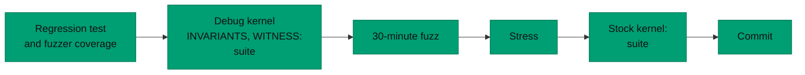

| Tool | What it catches |
|---|---|
| [`tests/kqring_test.c`](tests/kqring_test.c) | Behaviour of every supported opcode, registration and setup flag: 120 tests |
| [`tests/kqring_fuzz.c`](tests/kqring_fuzz.c) | Panics, hangs, CQ overruns and leaks, from random setups, SQEs, enters and register calls, with descriptors closed and arenas unmapped under requests |
| [`tests/kqring_stress.c`](tests/kqring_stress.c) | Races the suite can't time: threads, abrupt closes, forks and cancels, with leak checks |
| A KASAN kernel | Bad memory accesses at the instruction, with `kqring.ko` instrumented |
| [liburing's own tests](liburing/README.md) | Differences from Linux, in tests written for Linux |
| [fio](fio/README.md) and `kqring_diskbench -V` | Data integrity under load, and performance regressions |
