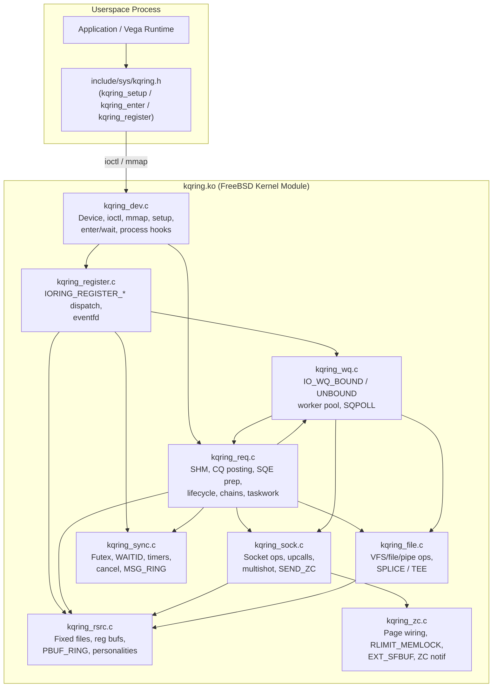
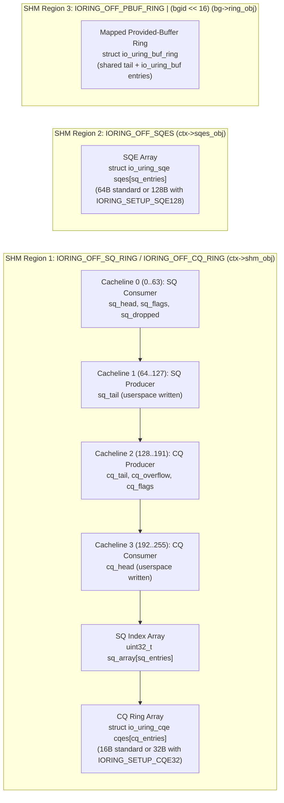
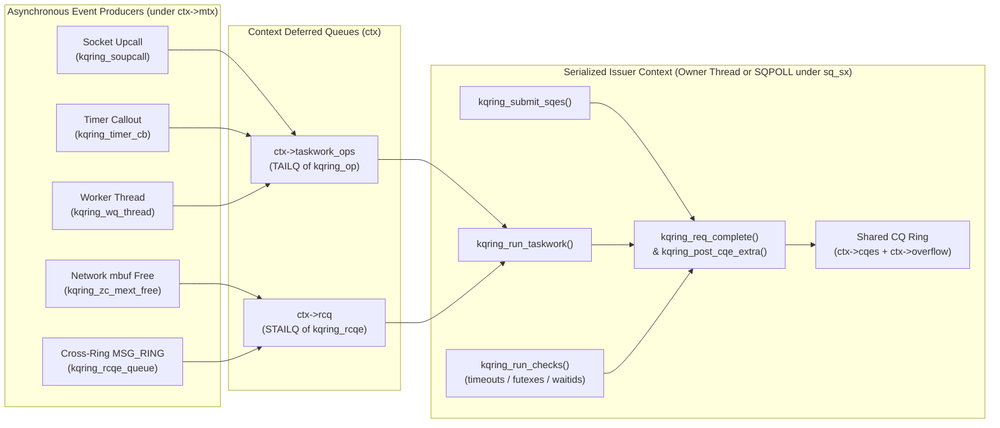
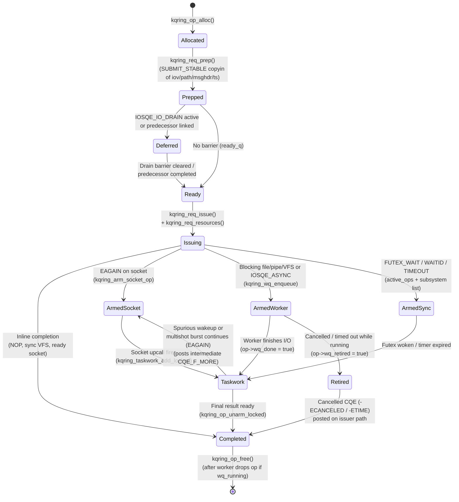
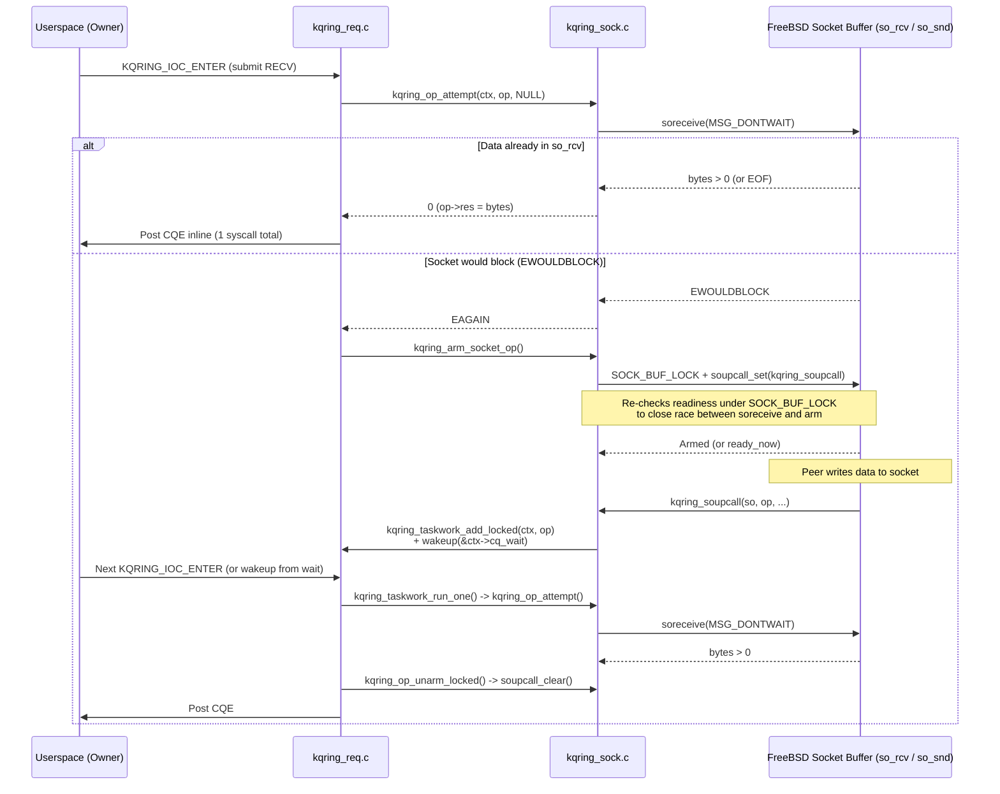
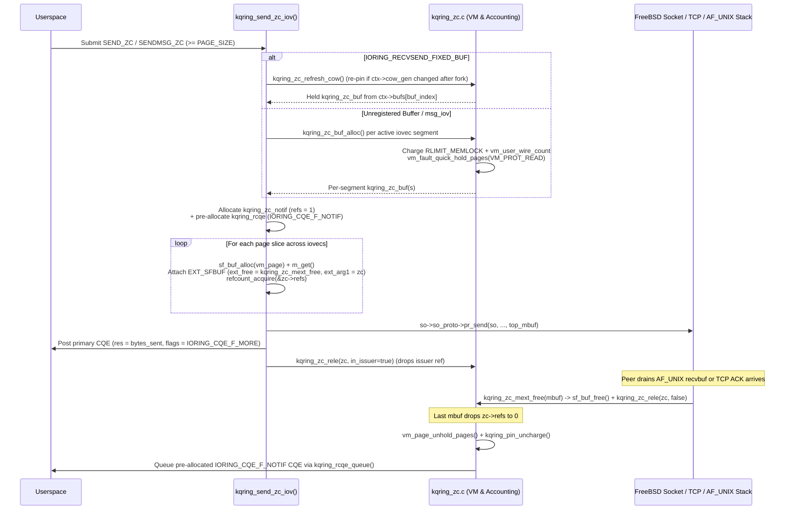
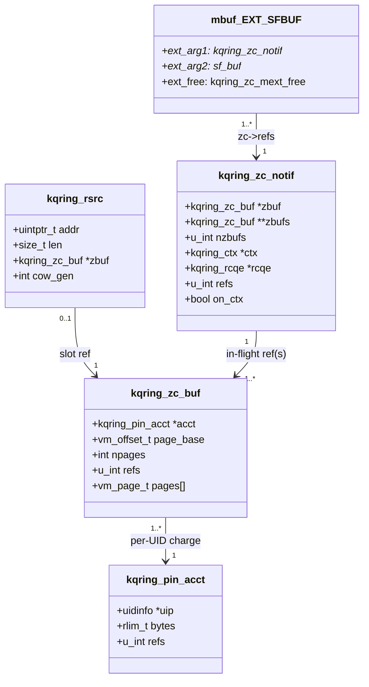
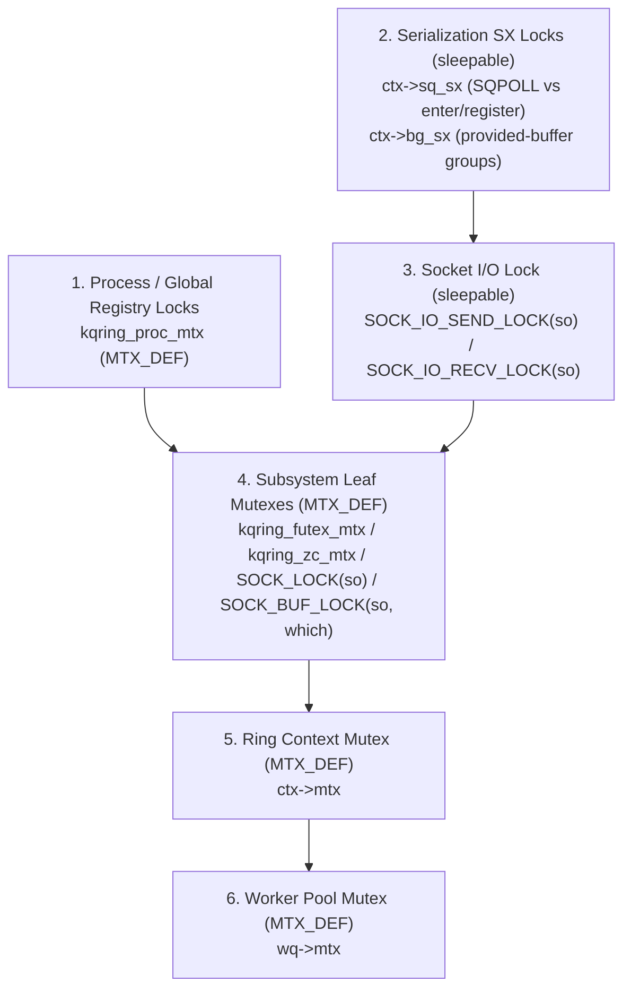

# `kqring` Architecture

`kqring.ko` is a loadable FreeBSD 14/15 kernel module implementing the Linux `io_uring` ABI over `/dev/kqring`, designed around the **`IORING_SETUP_SINGLE_ISSUER | IORING_SETUP_DEFER_TASKRUN`** execution model.

---

## 1. Module & Source Layout

The kernel module (`kmod/`) is split into nine translation units sharing a single private header ([`kmod/kqring_var.h`](kmod/kqring_var.h)) and one public UAPI header ([`include/sys/kqring.h`](include/sys/kqring.h)):

| File | Responsibility |
|---|---|
| [`include/sys/kqring.h`](include/sys/kqring.h) | Dual kernel/userspace UAPI header: `io_uring_sqe`, `io_uring_cqe`, `io_uring_params`, `io_uring_buf_ring`, `/dev/kqring` ioctls, opcode/flag constants, and inline userspace wrappers. |
| [`kmod/kqring_var.h`](kmod/kqring_var.h) | Kernel-internal structs (`kqring_ctx`, `kqring_op`, `kqring_wq`, `kqring_rsrc`, `kqring_bgroup`, `kqring_zc_buf`, `kqring_zc_notif`), limits, cross-TU prototypes, and hot-path `static inline` helpers. |
| [`kmod/kqring_dev.c`](kmod/kqring_dev.c) | `/dev/kqring` `cdevsw`, `kqring_open`, `kqring_ioctl`, `kqring_mmap_single`, ring setup/teardown, `kqring_wait_cqes`, process `exit`/`exec`/`fork` eventhandlers, and module load/unload. |
| [`kmod/kqring_req.c`](kmod/kqring_req.c) | OBJT_DEFAULT shared memory allocation, CQ ring posting and overflow queue, SQE preparation (`SUBMIT_STABLE` copyin), request allocation/free, chain/drain scheduling, and deferred taskwork execution. |
| [`kmod/kqring_rsrc.c`](kmod/kqring_rsrc.c) | Reference-counted fixed files (`ctx->files`) with Capsicum rights, registered buffers (`ctx->bufs`), classic & mmap provided-buffer rings (`ctx->bgroups`), and credential personalities. |
| [`kmod/kqring_register.c`](kmod/kqring_register.c) | `KQRING_IOC_REGISTER` dispatcher (`IORING_REGISTER_*`), restrictions, `IORING_REGISTER_PROBE`, and `eventfd` registration/signalling. |
| [`kmod/kqring_sock.c`](kmod/kqring_sock.c) | Non-blocking inline socket execution, `soupcall_set` / `solisten_upcall_set` arming, multishot `RECV`/`RECVMSG`/`ACCEPT`, `POLL_ADD`, `URING_CMD`, and `SEND_ZC`/`SENDMSG_ZC` mbuf construction. |
| [`kmod/kqring_file.c`](kmod/kqring_file.c) | Synchronous and worker-offloaded VFS/file/pipe operations (`READ`/`WRITE`, `READ_MULTISHOT`, `SPLICE`, `TEE`, `OPENAT`/`OPENAT2`, `STATX`, `*XATTR`, `FSYNC`, `FALLOCATE`, `FTRUNCATE`, `FADVISE`, `MADVISE`). |
| [`kmod/kqring_sync.c`](kmod/kqring_sync.c) | `FUTEX_WAIT`/`FUTEX_WAITV`/`FUTEX_WAKE` (`umtx_key`), `WAITID`, `callout`-backed `TIMEOUT`/`LINK_TIMEOUT`/`TIMEOUT_REMOVE`, `ASYNC_CANCEL`/`SYNC_CANCEL`, `POLL_REMOVE`, and cross-ring `MSG_RING`. |
| [`kmod/kqring_wq.c`](kmod/kqring_wq.c) | Per-ring or shared (`IORING_SETUP_ATTACH_WQ`) in-process kernel worker pools (`IO_WQ_BOUND` / `IO_WQ_UNBOUND`), non-blocking worker retirement/abort callout, and `IORING_SETUP_SQPOLL`. |
| [`kmod/kqring_zc.c`](kmod/kqring_zc.c) | Physical page holding (`vm_fault_quick_hold_pages`), per-UID `RLIMIT_MEMLOCK` & `vm.max_user_wired` accounting, `EXT_SFBUF` completion callbacks, and COW refresh on `fork(2)`. |

---

## 2. Shared-Memory Layout (`mmap_single`)

Each ring context (`struct kqring_ctx`) allocates two wired `vm_object_t` regions during `KQRING_IOC_SETUP` and optional per-group regions during `IORING_REGISTER_PBUF_RING` (`IOU_PBUF_RING_MMAP`). Each `mmap(2)` call acquires its own `vm_object_reference()`, preventing use-after-free if a buffer ring is unregistered while still mapped in userspace.

- **Cacheline separation:** [`struct kqring_shm_header`](kmod/kqring_var.h#L168-L185) places kernel-written and user-written indices on separate 64-byte cachelines to eliminate false sharing between userspace submission/reaping and kernel completion.
- **Overflow resilience:** If `cq_tail - cq_head >= cq_entries`, completions are queued in `ctx->overflow` (`TAILQ`) and `shm->cq_overflow` is incremented. `kqring_flush_overflow()` drains queued entries into the shared CQ ring as soon as userspace advances `cq_head`.

---

## 3. Execution Model (`SINGLE_ISSUER | DEFER_TASKRUN`)

`kqring` enforces a strict single-writer invariant for the Completion Queue (CQ), request lifecycle, and resource tables:

1. **Asynchronous contexts never write CQEs or mutate resource tables.** Socket upcalls, `callout` timer callbacks, `MSG_RING` senders, and in-process worker threads only enqueue work onto `ctx->taskwork_ops` (or `ctx->rcq` for `MSG_RING`), set `IORING_SQ_TASKRUN`, and wake the ring sleeper (`&ctx->cq_wait` / `ctx->sqpoll_Wait` / `ctx->evfd`).
2. **All completions and table mutations run on the serialized issuer path:**
   - **Standard mode:** The owning thread (`ctx->owner_tid`) inside `KQRING_IOC_ENTER`.
   - **`IORING_SETUP_SQPOLL` mode:** Either the in-process `kqring_sqpoll_thread` or the owning thread, mutually serialized by `sx_xlock(&ctx->sq_sx)`.

---

## 4. Request Lifecycle & State Machine

Every submitted SQE is represented by a `struct kqring_op` allocated in `kqring_submit_sqes()`.

### Key Invariants
- **`IORING_FEAT_SUBMIT_STABLE`:** `kqring_req_prep()` copies all indirect user arguments (`iovec` arrays, `msghdr`, `sockaddr`, file paths, `open_how`, xattr names/values, futex vectors, and `timespec`s) into kernel memory (`op->args`, charged against `ctx->arg_bytes <= KQRING_MAX_ARG_BYTES`) at submission time. Userspace can reuse or free argument memory immediately after `kqring_submit_sqes()` consumes the SQE.
- **Stack-bounded chain execution:** Linked requests (`IOSQE_IO_LINK`, `IOSQE_IO_HARDLINK`) and `IOSQE_IO_DRAIN` barriers are queued on `ctx->ready_q` and `ctx->defer_q` and driven iteratively by `kqring_flush_ready()`, never by recursive calls.

---

## 5. Socket Fast Path & Upcall Arming (`kqring_sock.c`)

Socket operations (`RECV`, `SEND`, `RECVMSG`, `SENDMSG`, `SEND_ZC`, `SENDMSG_ZC`, `ACCEPT`, `CONNECT`, `POLL_ADD`, and socket `READ`/`WRITE`) follow an **inline-first, upcall-fallback** pipeline:

- **One-op-per-direction guard:** FreeBSD sockets provide a single `so_upcall` slot per sockbuf (`so_rcv`, `so_snd`). `kqring_arm_socket_op()` checks `sb->sb_upcall != NULL` under `SOCK_BUF_LOCK` and fails a conflicting second armed request on the same socket and direction with `-EBUSY` rather than silently overwriting the existing upcall.
- **`listen(2)` race protection:** On FreeBSD 15, `solisten_proto()` converts a socket's `so_rcv`/`so_snd` union into listen queues under both sockbuf locks. Every sockbuf lock acquisition in `kqring_sock.c` re-checks `SOLISTENING(so)` before touching `so_rcv` or `so_snd`.

---

## 6. Zero-Copy Transmit (`SEND_ZC` / `SENDMSG_ZC`)

`kqring` implements true zero-copy transmit for connected `AF_UNIX` and `AF_INET`/`AF_INET6` TCP stream sockets on transfers of at least `PAGE_SIZE` (4 KiB), supporting both **Phase A** (`IORING_RECVSEND_FIXED_BUF` registered buffers) and **Phase B** (unregistered user buffers and multi-segment scatter/gather `SENDMSG_ZC`).

### Zero-Copy Ownership & Accounting Model

- **Decoupled page lifetime:** `RLIMIT_MEMLOCK` and `vm_user_wire_count` charges live on `kqring_zc_buf`, not on the ring slot. Unregistering a buffer or closing the ring while zero-copy mbufs are still unread in a peer socket or awaiting TCP ACK keeps the pages held and charged until the last `EXT_SFBUF` mbuf is freed.
- **Copy-on-write safety (`fork`):** `kqring_proc_fork` increments `ctx->cow_gen` on every ring in the parent process. Before a registered buffer is used for `SEND_ZC` or `SENDMSG_ZC`, `kqring_zc_refresh_cow()` compares `r->cow_gen` with `ctx->cow_gen` and re-pins the post-fork physical pages (discounting the old buffer's pages from the `RLIMIT_MEMLOCK` check if no unread mbuf holds an extra reference to the old `kqring_zc_buf`).
- **Module unload barrier:** Each active `kqring_zc_notif` increments `kqring_live_zc` via `kqring_zc_hold()`. `MOD_QUIESCE` rejects `kldunload` with `EBUSY` while `kqring_live_zc > 0`, and `MOD_UNLOAD` sets `kqring_unloading = true` and drains `kqring_live_zc` so no `EXT_SFBUF` mbuf can ever invoke `kqring_zc_mext_free` after `kqring.ko` is unmapped.

---

## 7. In-Process Worker Pool & Detached Cancellation (`kqring_wq.c`)

Blocking operations on regular files, pipes, FIFOs, devices, VFS paths, `WAITID`, non-socket `POLL_ADD`, and any SQE with `IOSQE_ASYNC` execute on an in-process kernel worker pool (`struct kqring_wq`, `IORING_FEAT_NATIVE_WORKERS`):

- **Two sub-pools per `kqring_wq`:**
  - `IO_WQ_BOUND` (default cap 64): regular file/device I/O.
  - `IO_WQ_UNBOUND` (default cap 256): pipes, FIFOs, VFS metadata/path operations, `SPLICE`/`TEE`, `WAITID`, and non-socket readiness waits.
- **Address-space sharing:** Workers are created with `kproc_kthread_add(..., td->td_proc)` inside the ring owner's `struct proc`, so `copyin`/`copyout`/`uiomove` and credential switching (`kqring_cred_enter`) work directly on user addresses without cross-process VM mapping.
- **Non-blocking cancellation & detached close:**
  - When an armed worker request is cancelled (`ASYNC_CANCEL`, `SYNC_CANCEL`, `POLL_REMOVE`, `LINK_TIMEOUT`, or ring close), `kqring` never blocks the issuer waiting for the worker thread.
  - Instead, the op is moved to `ctx->retired_ops` (`op->wq_retired = true`), its `-ECANCELED` (or `-ETIME`) CQE is posted via taskwork, `kqring_wq_abort_td()` sends `sleepq_abort(wtd, EINTR)` to interrupt any interruptible sleep, and `ctx->wq_abort_callout` periodically re-sends the interrupt every 1 ms until the worker exits its syscall and releases the op.
  - On `close(ring_fd)`, `kqring_dtor()` detaches any still-running workers (`op->wq_abandoned = true`) and defers final `kqring_ctx` / `kqring_wq` destruction until the last detached worker drops its `ctx->refs` reference (`kqring_ctx_rele()`).

---

## 8. Locking Hierarchy & Concurrency Invariants

To prevent deadlocks across synchronous submission, socket upcalls, callouts, worker threads, and process lifecycle hooks, `kqring` enforces a strict lock acquisition order:

| Lock | Type | Protects | Ordering Rules |
|---|---|---|---|
| `kqring_proc_mtx` | `MTX_DEF` | `kqring_proc_hash`, `kqring_ctx_list`, `kqring_live_workers`, `kqring_live_zc`, `kqring_unloading` | Acquired before `ctx->mtx` or `wq->mtx` during process `exit`/`exec`/`fork` and module unload. |
| `ctx->sq_sx` | `struct sx` | Serializes `kqring_sqpoll_thread`, `KQRING_IOC_ENTER` submission/taskwork, and `KQRING_IOC_REGISTER` | Sleepable outer lock; never held by upcalls, callouts, or workers. |
| `ctx->bg_sx` | `struct sx` | `ctx->bgroups` hash, `PROVIDED_BUFFERS`, `PBUF_RING` selection/commit | Sleepable lock; nests inside `ctx->sq_sx` and outside `SOCK_BUF_LOCK` / `ctx->mtx`. |
| `SOCK_IO_SEND_LOCK` | `struct sx` | Serializes socket send operations (`kqring_send_zc_iov`, `sosend`) | Acquired before `SOCK_BUF_LOCK`, `kqring_zc_mtx`, and `ctx->mtx`. |
| `SOCK_BUF_LOCK` | `MTX_DEF` | Socket buffer state (`so_rcv` / `so_snd`) and `sb_upcall` | Acquired **before** `ctx->mtx` (matching the order in which `sowakeup` -> `kqring_soupcall` enters `kqring`). |
| `kqring_futex_mtx` | `MTX_DEF` | Global `kqring_futex_hash` table | Acquired **before** `ctx->mtx`. |
| `kqring_zc_mtx` | `MTX_DEF` | `kqring_pin_acct_hash` and `zc_notif->ctx` detachment | Acquired **before** `ctx->mtx`. |
| `ctx->mtx` | `MTX_DEF` | `taskwork_ops`, `active_ops`, `retired_ops`, `rcq`, `zc_pending`, `cq_wait`, `evfd` | Leaf lock relative to socket/futex/ZC locks; only `wq->mtx` may nest inside `ctx->mtx`. |
| `wq->mtx` | `MTX_DEF` | Worker pool queues (`q[2]`), thread lists, worker counts, `wq->refs` | Innermost mutex; never acquires `ctx->mtx` while held. |

---

## 9. Process Lifecycle & Security Boundaries

- **Process exit (`kqring_proc_exit`):** Releases `ctx->files` and `ctx->bufs` and stops workers/SQPOLL for every ring created by the exiting process. This breaks any `AF_UNIX` `SCM_RIGHTS` reference cycle where a ring descriptor is in flight inside an unread socket buffer whose endpoint is also installed in `ctx->files`.
- **Process `execve(2)` (`kqring_proc_exec`):** Marks all rings owned by the process as `ctx->closing = true`, stops `SQPOLL` and workers, disarms all in-flight operations, and frees fixed resource tables so a new executable image cannot inherit active asynchronous kernel operations or pre-execve credentials.
- **Process `fork(2)` (`kqring_proc_fork`):** Increments `ctx->cow_gen` on all rings in the parent process so any registered buffer (`IORING_RECVSEND_FIXED_BUF`) refreshes its held physical pages on the next zero-copy send after copy-on-write mappings are established.
- **Capsicum (`CAP_RIGHTS` & `IN_CAPABILITY_MODE`):**
  - Fixed-file slots snapshot the `struct filecaps` of the descriptor at registration/install time and validate every operation against those rights.
  - Direct descriptors created via `OPENAT`/`OPENAT2` inherit the directory descriptor's Capsicum rights.
  - Personalities registered prior to `cap_enter(2)` are rejected with `-ECAPMODE` once the process enters capability mode, preventing sandbox escape via `sqe->personality`.

