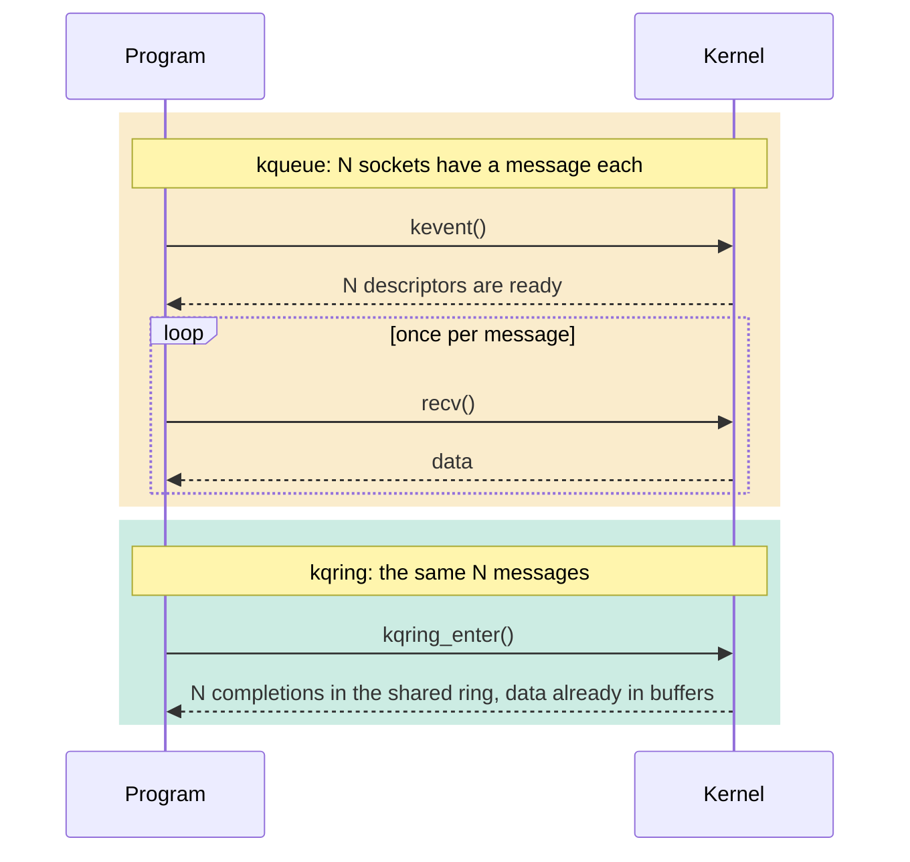
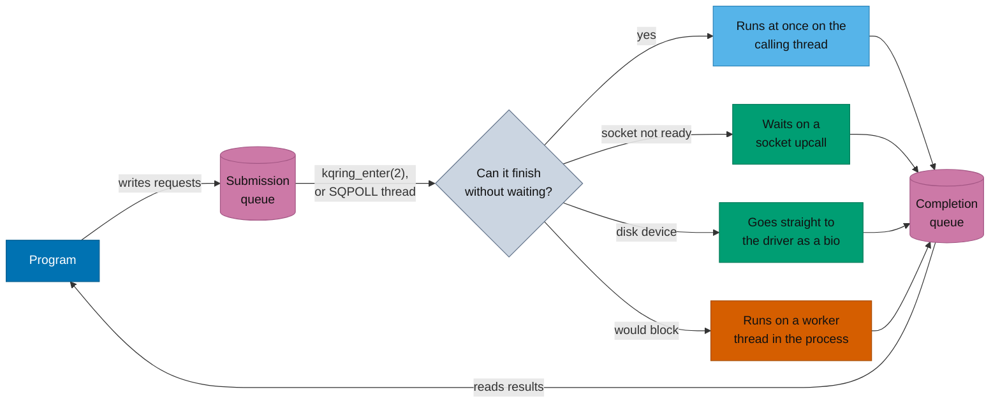

# kqring — io_uring for FreeBSD

<p align="center">
  
</p>

`kqring` brings Linux's [`io_uring`](https://kernel.dk/io_uring.pdf) asynchronous I/O interface to FreeBSD, as a loadable kernel module (`kqring.ko`) for FreeBSD 15.1 (amd64). Programs written for io_uring build against it with three system call wrappers changed, [liburing](liburing/) and [fio](fio/) run on it, and it adds operations of its own that io_uring doesn't have.

> **Experimental preview, for test systems only.** kqring is an out-of-tree kernel module, and a bug in it can crash the machine. It has **not** had an independent security audit. See [Should you use it?](#should-you-use-it)

## What kqring is

A program and the kernel share two ring buffers in memory. The program writes requests into one, the **submission queue**, and reads results from the other, the **completion queue**. One system call can submit hundreds of requests and collect hundreds of results, and some programs need no system call at all.

kqring uses the io_uring ABI as it is, with the same structure layouts and `IORING_*` constants:
- submission and completion queues shared with the kernel through `mmap(2)`;
- `struct io_uring_sqe`, `struct io_uring_cqe` and `struct io_uring_params`;
- provided-buffer rings.

Code written against `<linux/io_uring.h>` builds against [`<sys/kqring.h>`](include/sys/kqring.h) instead.

## Why kqring exists

**io_uring has no FreeBSD equivalent, and software is being written for it.** Storage engines, network servers and runtimes on Linux use io_uring directly or through liburing. On FreeBSD they need a second I/O backend, or they fall back to something slower. The goal of kqring is io_uring for FreeBSD in general: for any io_uring user, not for one application.

**FreeBSD's own interfaces each do part of the job.** `kqueue(2)` is excellent at saying that a descriptor is *ready*, but the program still makes a system call for each read or write. `aio(4)` does asynchronous I/O, but with its own calling convention and a completion per request. A ring does both in one interface: it says an operation is *finished*, and many operations share one system call.



That is N + 1 system calls against one, which is why the gap is widest for busy servers.

| | `kqueue(2)` | `aio(4)` | kqring |
|---|---|---|---|
| Tells the program | a descriptor is ready | a request finished | a request finished |
| Does the I/O | no, the program calls `read` / `write` | yes | yes |
| Requests per system call | | many, with `lio_listio(2)` | many |
| Results per system call | many events | one with `aio_waitcomplete(2)`, or many through a kqueue | many, or none if polling the ring |
| Sockets, files, disks, timers, pipes in one queue | notification only | sockets, files and disks | yes |
| Chains of dependent requests | no | no | yes, linked requests |
| Zero-copy send | no | no | yes, `SEND_ZC` |
| Code written for Linux io_uring | no | no | yes |

## How it works



Requests that can finish immediately do, on the calling thread. Everything that has to wait is parked without blocking the program, and all results are posted by one thread, so the completion queue needs no lock against the program. [ARCHITECTURE.MD](ARCHITECTURE.MD) has the details.

## What works today

kqring implements most of io_uring:
- about 60 opcodes, multishot operations, linked requests, timeouts and cancellation;
- fixed files, registered and provided buffers;
- zero-copy send, `SQPOLL` and in-process worker threads.

It also has [extensions](#kqring-extensions) of its own: event-driven chains, requests for any kqueue event, and a bridge that delivers an existing kqueue's events as completions.


Of the 8 failures, 6 come from Linux-only assumptions in the tests and 2 are deliberate differences. [`liburing/README.md`](liburing/README.md) explains each one.

| How it's tested | Result on `v0.3.0` |
|---|---|
| kqring's own suite, stock and debug kernels | 127 tests pass |
| Fuzzer, whole interface, 30 minutes on a debug kernel | clean, no leaks |
| Stress test, 10 minutes on a debug kernel | clean, no leaks |
| KASAN kernel with `kqring.ko` instrumented: suite, stress and 7 full fuzz runs | no memory errors reported in kqring |
| liburing 2.9's test suite | 179 of 196 pass, every failure explained |
| `kqring_diskbench -V`, every read checked against what was written | passed on an md(4) disk and a ZFS file |

It has also been reviewed against the classes of bugs behind Linux io_uring's CVEs.

---

## Performance against kqueue


Compared with `kqueue(2)`, or the plain system call where kqueue has no role, on a 4-core i5-8250U running FreeBSD 15.1. Medians of 5 runs of `v0.3.0`, in ns per operation, lower is better.

| Workload | Baseline | kqring | Result |
|---|---:|---:|---|
| Fan-in, 16 sockets, 64 B | 831 (kqueue) | 676 (multishot `RECV`) | **19% faster** |
| Fan-in, 1,024 sockets, 64 B | 870 (kqueue) | 709 (batched `RECV`) | **18% faster** |
| AF_UNIX ping-pong, 64 B | 1,117 (kqueue) | 881 (`RECV`, reused buffer) | **21% faster** |
| AF_UNIX ping-pong, 64 B | 1,117 (kqueue) | 939 (multishot `RECV`) | **16% faster** |
| AF_UNIX ping-pong, 64 B | 1,117 (kqueue) | 1,393 (`RECV` armed first) | 25% slower |
| TCP ping-pong, 64 B | 5,948 (kqueue) | 5,891 (multishot `RECV`) | level |
| TCP `ACCEPT` | 16,283 (kqueue) | 16,113 (multishot) | level |
| TCP `ACCEPT` | 16,283 (kqueue) | 14,320 (multishot, 50 µs busy-poll) | **12% faster** |
| Pipe read, 64 B, data ready | 1,026 (kqueue) | 848 (`READ`) | **17% faster** |
| 1 µs timer | 9,412 (`EVFILT_TIMER`) | 4,898 (`TIMEOUT`) | **1.9× faster** |
| Empty call | 288 (`kevent`) | 336 (`NOP`, one per enter) | 16% slower |
| Empty call | 288 (`kevent`) | 69 (`NOP`, 32 per enter) | **4.2× faster** |
| AF_UNIX send, 256 KiB | 25,746 (`write`) | 11,069 (`SEND_ZC`, registered) | **2.3× faster** |
| TCP send, 256 KiB | 56,215 (`write`) | 41,974 (`SEND_ZC`, registered) | **25% faster** |
| TCP send, 16 KiB | 7,433 (`write`) | 7,685 (`SEND`) | 3% slower |
| 4 KiB disk read | 5,280 (`pread`) | 1,837 (`READ`, 32 per enter) | **2.9× faster** |
| 4 KiB disk read | 5,280 (`pread`) | 5,842 (`READ`, one per enter) | 11% slower |
| 4 KiB UFS cached read | 1,189 (`pread`) | 1,028 (`READ`, 32 per enter) | **13% faster** |
| 4 KiB UFS cached read | 1,189 (`pread`) | 1,328 (`READ`, one per enter) | 12% slower |

<p align="center">
  
  
</p>
<p align="center">
  
  
</p>
<p align="center">
  
  
</p>

These are mostly single-threaded loopback measurements of what each mechanism costs. [`BENCHMARK.MD`](BENCHMARK.MD) has the method, every result and the known gaps, and the raw runs are in [`docs/bench/data/`](docs/bench/data/).

### Where kqring is faster

1. **Servers with many active connections:** 18%–19% faster. One enter collects every ready message.
2. **Steady receive:** multishot `RECV`, or `RECV` into a reused buffer, needs no separate wake-up before the read.
3. **Bulk sends from 32–64 KiB up:** `SEND_ZC` from a registered buffer avoids copying user memory into the kernel.
4. **Disks with requests in flight:** batched requests reach the driver together, which one thread calling `pread(2)` can't do.
5. **Anything you can batch:** 32 `NOP`s per enter cost 69 ns each, against 288 ns for an empty `kevent(2)`.
6. **Event-driven chains:** a [trigger](#kqring-extensions) echo server spends less CPU per message than kqueue, because it never returns to user space between messages.

### Where kqueue or direct system calls are better

1. **One-shot `RECV` armed before the data arrives:** 25% slower at 64 B. It takes a second enter and sets up a socket upcall each time. Use multishot.
2. **One operation at a time:** a single request per enter costs more than the plain call, as the `NOP` and `READ` rows show. The ring pays off with several requests in flight.
3. **Cached reads on ZFS:** ZFS has no page-cache read path, so reads go through a worker, and `pread(2)` is faster. On UFS, batched reads win.
4. **Many threads reading cached data:** from 4 threads, `pread(2)` passes kqring's worker path, because a thread reading the cache itself needs no hand-off. Once the readers take most of the CPUs, kqring runs those reads in the submitting thread too; on an 8-thread Ryzen that cut `psync`'s lead at 8 jobs from 32% to 10% ([docs/worker-wakeups.md](docs/worker-wakeups.md#reads-in-the-submitting-thread)).
5. **`sendfile(2)` with kernel TLS:** for serving files to the network, keep `sendfile(2)`. It moves file pages to the NIC without passing through user space.

## Storage performance

With [fio](fio/README.md)'s own `io_uring` engine, on a SATA SSD and on `md(4)` disks. kqring reaches what the SSD can do, 98,876 IOPS at 32 in flight, with less than half of `aio(4)`'s CPU.


<p align="center">
  
  
</p>

On a ZFS file at 32 in flight, kqring is 4–5% behind `aio(4)` in IOPS and has a longer latency tail, at less than half the CPU. See [`BENCHMARK.MD`](BENCHMARK.MD#fio-on-a-real-ssd).

## Should you use it?

**Try it** if you're porting or testing software written for io_uring on FreeBSD, measuring whether a ring helps your workload, or want to work on kqring itself.

**Don't use it in production yet.** It's an experimental preview, it runs in the kernel, and it hasn't been audited. It is built and tested on FreeBSD 15.1 amd64 with the `GENERIC` kernel only.

Some things differ from Linux; see [Differences from Linux](#differences-from-linux), [Known gaps](BENCHMARK.MD#known-gaps) and the [compatibility matrix](COMPATIBILITY.MD).

---

## Quick start

Built and tested on FreeBSD 15.1-RELEASE, amd64, `GENERIC` kernel; other versions are untested. Kernel sources must be installed in `/usr/src` and match the running kernel (`freebsd-version -ku`). Version 0.3.0 is an experimental preview; see [`CHANGELOG.md`](CHANGELOG.md).

```sh
make                                   # builds kmod/kqring.ko, tests/kqring_test, tests/kqring_bench
sudo kldload ./kmod/kqring.ko          # creates /dev/kqring
./tests/kqring_test                    # functional test suite
./tests/kqring_bench                   # benchmarks (the send group needs ulimit -l 8192; see BENCHMARK.MD)
sudo kldunload kqring
```

---

## Using kqring from io_uring code

[`<sys/kqring.h>`](include/sys/kqring.h) provides the io_uring structures and constants, plus three wrappers with the same arguments as Linux's system calls:

| Linux system call | kqring wrapper |
|---|---|
| `io_uring_setup(entries, params)` | `kqring_setup(entries, params)` |
| `io_uring_enter(fd, to_submit, min_complete, flags, arg, argsz)` | `kqring_enter(fd, to_submit, min_complete, flags, arg, argsz)` |
| `io_uring_register(fd, opcode, arg, nr_args)` | `kqring_register(fd, opcode, arg, nr_args)` |

The rings are mapped exactly as on Linux: `mmap(2)` on the ring descriptor at `IORING_OFF_SQ_RING`, `IORING_OFF_SQES` and `IORING_OFF_PBUF_RING`, using the offsets returned in `struct io_uring_params`. So a program with its own syscall wrappers ports like this:

```c
#if defined(__linux__)
#include <linux/io_uring.h>
#include <sys/syscall.h>
#include <unistd.h>
#define uring_setup(entries, p) \
	syscall(__NR_io_uring_setup, (entries), (p))
#define uring_enter(fd, submit, wait, flags, arg, argsz) \
	syscall(__NR_io_uring_enter, (fd), (submit), (wait), (flags), (arg), (argsz))
#define uring_register(fd, op, arg, nr) \
	syscall(__NR_io_uring_register, (fd), (op), (arg), (nr))
#elif defined(__FreeBSD__)
#include <sys/kqring.h>
#define uring_setup(entries, p)                          kqring_setup((entries), (p))
#define uring_enter(fd, submit, wait, flags, arg, argsz) kqring_enter((fd), (submit), (wait), (flags), (arg), (argsz))
#define uring_register(fd, op, arg, nr)                  kqring_register((fd), (op), (arg), (nr))
#endif
```

The wrappers make native system calls, which the module registers in free system-call slots when it loads; `sysctl kern.kqring.sys_setup`, `sys_enter` and `sys_register` give their numbers. `kqring_setup()` opens `/dev/kqring` and returns the new ring's descriptor. Where no slot was free, the wrappers fall back to `ioctl(2)` on the ring descriptor, which costs about 90 ns more per call. Like the Linux system calls, they return −1 and set `errno` on failure. Completion results (`cqe->res`) are negated **FreeBSD** errno values, and flags passed through SQEs (`O_*`, `MSG_*` and so on) use their FreeBSD values; see [Differences from Linux](#differences-from-linux).

Programs that use liburing build against the port in [`liburing/`](liburing/), which fetches liburing 2.15 and builds it with kqring's system calls; see [`liburing/README.md`](liburing/README.md).

### Requirements

- **Rings belong to one process.** Without `IORING_SETUP_SINGLE_ISSUER`, any thread of the process that created the ring may submit, wait and register; with it, only the creating thread may (`EEXIST` otherwise). Another thread's enter that submits nothing is allowed, as on Linux, but it can't wait for completions that haven't been posted yet. Another process, such as a forked child, cannot use the ring except to wake an `SQPOLL` thread (see [Differences from Linux](#differences-from-linux)).
- **`IORING_SETUP_DEFER_TASKRUN` is the fastest mode.** It requires `SINGLE_ISSUER`, as on Linux, and completions are posted when the owner enters the ring. Without it, a kernel thread in the process posts completions as they happen, which costs a thread switch per batch.
- **Raise `RLIMIT_MEMLOCK` to register buffers.** Registered buffers' pages are held for zero-copy send and charged to the user's locked-memory limit, which FreeBSD sets to only 64 KiB by default (Linux uses 8 MiB). Set `memorylocked` in `login.conf(5)`, or use `ulimit -l`.

---

## Supported operations

**How requests run.**
- **Sockets** are tried inline in `kqring_enter()` (unless `IOSQE_ASYNC` is set); if the socket isn't ready, the request waits on a socket upcall.
- **Also inline:** positioned file reads that the page cache satisfies, and a `READ` on a pipe that has data or a `WRITE` to one with room, blocking or not. So are reads of a file on a local filesystem whose ring's recent reads didn't sleep, such as ZFS reads the ARC serves, while threads in enters take more than half the CPUs ([docs/worker-wakeups.md](docs/worker-wakeups.md#reads-in-the-submitting-thread)).
- **Straight to the disk driver:** positioned `READ` and `WRITE` (plain, vectored and `_FIXED`) on a disk device (`/dev/ada0`, `nda0`, `md0`, GEOM partitions) go to the driver as bios over the held user pages, as `aio(4)` does, with no worker thread and any number in flight. Lengths must be whole sectors; anything else runs on a worker. In-flight disk I/O can't be cancelled (`ASYNC_CANCEL` returns `-EALREADY`, as io_uring does for running block I/O).
- **On workers:** other file, pipe and VFS requests, `WAITID` and `IOSQE_ASYNC` requests run on per-ring kernel worker threads (`IO_WQ_BOUND` and `IO_WQ_UNBOUND`, `IORING_FEAT_NATIVE_WORKERS`). These live in the ring owner's process, sharing its address space and descriptor table, and hand completions back to the owner.
- **On the owner's path:** futexes and timers.
- **With `IORING_SETUP_SQPOLL`:** a kernel thread in the process consumes SQEs, so the owner need not enter the ring to submit.

- **I/O:** `READ`, `WRITE`, `READV`, `WRITEV`, `READ_FIXED`, `WRITE_FIXED`, `READV_FIXED`, `WRITEV_FIXED`, `FSYNC`, `SYNC_FILE_RANGE`, `FALLOCATE`, `FTRUNCATE`, `FADVISE`, `MADVISE`, `SPLICE`, `TEE`.
  - `READ` and `READV` (with one iovec) take a provided buffer.
  - On a socket, the read and write operations wait like `RECV` and `SEND` instead of blocking.
  - `SPLICE` moves data between two descriptors where at least one is a pipe; `TEE` duplicates pipe buffer bytes to another pipe without consuming the source.
- **Sockets & Pipes:** `RECV`, `SEND`, `RECVMSG`, `SENDMSG`, `SEND_ZC`, `SENDMSG_ZC`, `ACCEPT`, `CONNECT`, `SOCKET`, `BIND`, `LISTEN`, `SHUTDOWN`, `READ_MULTISHOT`, `URING_CMD`.
  - Multishot is supported for `RECV`, `RECVMSG`, `ACCEPT` and `READ_MULTISHOT` (on both sockets and pipes).
  - `MSG_WAITALL` works on stream sockets, and `SEND` can take a destination address.
  - `SEND` can send from provided buffers, and `RECV` and `SEND` take bundles (`IORING_RECVSEND_BUNDLE`, up to 32 buffers per CQE, `IORING_FEAT_RECVSEND_BUNDLE`). As in Linux, a bundle `SEND` on a stream socket sends each batch whole and goes on with `IORING_CQE_F_MORE` until the group is empty.
  - `ACCEPT` CQEs carry `IORING_CQE_F_SOCK_NONEMPTY` when more connections are queued.
  - `SEND_ZC` can send from a registered buffer (`IORING_RECVSEND_FIXED_BUF`).
  - `URING_CMD` supports `SIOCINQ`, `SIOCOUTQ`, `GETSOCKOPT` and `SETSOCKOPT`.
- **Files and paths:** `OPENAT`, `OPENAT2`, `CLOSE`, `PIPE`, `STATX`, `RENAMEAT`, `UNLINKAT`, `MKDIRAT`, `SYMLINKAT`, `LINKAT`, `GETXATTR`, `SETXATTR`, `FGETXATTR`, `FSETXATTR`.
- **Fixed files and buffers:** `FILES_UPDATE` (including `IORING_FILE_INDEX_ALLOC`), `FIXED_FD_INSTALL`, `PROVIDE_BUFFERS`, `REMOVE_BUFFERS`.
  - `OPENAT`, `OPENAT2`, `ACCEPT` (including multishot), `SOCKET` and `PIPE` can create direct descriptors (`file_index`), and `CLOSE` can close them.
- **Synchronisation:** `FUTEX_WAIT`, `FUTEX_WAITV`, `FUTEX_WAKE`, `WAITID`, `MSG_RING` (`IORING_MSG_DATA` and `IORING_MSG_SEND_FD`, including 32-byte `big_cqe` payload transfer on `SQE128` + `CQE32` rings).
- **Control:** `NOP`, `POLL_ADD` (including multishot on sockets, pipes, eventfds, and files; on anything but a socket it is a knote on a kqueue the ring owns, served by one kernel thread per ring), `POLL_REMOVE`, `TIMEOUT`, `TIMEOUT_REMOVE`, `LINK_TIMEOUT`, `ASYNC_CANCEL` (including `IORING_ASYNC_CANCEL_FD_FIXED`).
- **Setup flags:**
  - `IORING_SETUP_SINGLE_ISSUER`, `IORING_SETUP_DEFER_TASKRUN`, `IORING_SETUP_CQSIZE`, `IORING_SETUP_CLAMP`, `IORING_SETUP_R_DISABLED`, `IORING_SETUP_SUBMIT_ALL`, `IORING_SETUP_COOP_TASKRUN`, `IORING_SETUP_TASKRUN_FLAG`, `IORING_SETUP_SQE128`, `IORING_SETUP_CQE32`, `IORING_SETUP_ATTACH_WQ`, `IORING_SETUP_SQPOLL`, `IORING_SETUP_SQ_AFF`, `IORING_SETUP_IOPOLL`, `IORING_SETUP_NO_MMAP` (rings in the caller's memory, which `fork(2)` then shares rather than copies), `IORING_SETUP_NO_SQARRAY` and `IORING_SETUP_REGISTERED_FD_ONLY`.
- **SQE flags:** `IOSQE_FIXED_FILE`, `IOSQE_IO_LINK`, `IOSQE_IO_HARDLINK`, `IOSQE_IO_DRAIN`, `IOSQE_ASYNC`, `IOSQE_CQE_SKIP_SUCCESS` and `IOSQE_BUFFER_SELECT` (any group), plus `sqe->personality`.
- **Registration:**
  - Files: `FILES`, `FILES2`, `FILES_UPDATE`, `FILES_UPDATE2`, `UNREGISTER_FILES` and `FILE_ALLOC_RANGE`, with sparse tables and tags.
  - Buffers: `BUFFERS`, `BUFFERS2`, `BUFFERS_UPDATE`, `UNREGISTER_BUFFERS` and `CLONE_BUFFERS` (including `IORING_REGISTER_SRC_REGISTERED`).
  - Buffer rings: `PBUF_RING` (including `IOU_PBUF_RING_MMAP` and `IOU_PBUF_RING_INC`), `UNREGISTER_PBUF_RING` and `PBUF_STATUS`.
  - Ring descriptors: `RING_FDS` and `UNREGISTER_RING_FDS` (with `IORING_ENTER_REGISTERED_RING`, `IORING_REGISTER_USE_REGISTERED_RING`, and `IORING_FEAT_REG_REG_RING`).
  - Workers: `IOWQ_AFF`, `UNREGISTER_IOWQ_AFF` and `IOWQ_MAX_WORKERS`.
  - Rings: `RESIZE_RINGS` (on `DEFER_TASKRUN` rings, as on Linux; queued SQEs and CQEs move to the new rings, which are mapped afresh).
  - Other: `EVENTFD`, `EVENTFD_ASYNC`, `UNREGISTER_EVENTFD`, `PERSONALITY`, `UNREGISTER_PERSONALITY`, `RESTRICTIONS`, `ENABLE_RINGS`, `PROBE`, `SYNC_CANCEL`, `SEND_MSG_RING` and `CLOCK`.

`IORING_REGISTER_PROBE` reports exactly which opcodes are available. These Linux operations have no FreeBSD equivalent and are rejected with `-EOPNOTSUPP` or `-EINVAL`: `EPOLL_CTL`, `EPOLL_WAIT` and `RECV_ZC`. `IORING_REGISTER_NAPI` is accepted, but FreeBSD has no NAPI polling for a module to call, so it sets only a busy-wait: a wait spins up to `busy_poll_to` µs for completions before it sleeps. The static NAPI id operations fail with `EOPNOTSUPP`.

## kqring extensions

kqring adds operations io_uring doesn't have. A ring is plain io_uring until the program opts in with the `KQRING_IOC_EXT_SETUP` ioctl on the ring descriptor. The ring then has one *escape opcode* (default `0xFF`, which the program can change), and `sqe->ioprio` picks the extension. None of this uses an io_uring opcode, flag or field, so programs written for Linux behave exactly as on Linux, and kqring can follow every future io_uring opcode at its Linux number.

- **Event-driven chains** (`KQRING_EXT_TRIGGER`): a trigger request watches a descriptor's readiness and runs the up to 8 requests linked after it as a fresh chain each time the descriptor becomes ready, with no system call per event. "Whenever this socket is readable, receive and then send a reply" is one submission. `SERIAL` triggers run one chain at a time and re-arm when it's done; `CONCURRENT` ones start a chain per event, up to a limit. A trigger ends when cancelled, when its descriptor hangs up, or on a failed run if asked.
- **The kqueue bridge** (`KQRING_EXT_KQUEUE`): attach an existing kqueue to a ring, and the events that any code registers on it, such as libevent or libuv, arrive as CQEs with their `udata`. A program can then move to kqring one part at a time, with one wait for both.
- **Kevent requests** (`KQRING_EXT_KEVENT`): wait for a kqueue event io_uring has no request for, one-shot or multishot with a CQE per event. `EVFILT_VNODE` reports a file or directory being written, extended, renamed, deleted or changed (Linux needs inotify), `EVFILT_SIGNAL` a signal's deliveries (Linux needs signalfd), `EVFILT_READ` / `EVFILT_WRITE` how much can be read or written (as `FIONREAD` would tell after a `POLL_ADD`), and `EVFILT_PROC` any process's exit, fork or exec, with the exit status in a 32-byte CQE (`WAITID` only waits for children). The same events can drive a trigger (`KQRING_TRIG_SRC_KEVENT`): "whenever this file is written, read it" is one submission.
- **Step flags** pass one request's result to the next within a run: `KQRING_STEP_LEN_FROM_PREV` sets a step's length to the bytes the step before it moved, `KQRING_STEP_STOP_ON_ZERO` ends the trigger when the step before it reads end of file, and `KQRING_STEP_BUF_FROM_PREV` hands a step the provided buffer the step before it filled, giving the buffer back to its group afterwards. A `RECV` → `SEND` pair with both makes an echo server that posts no CQE and needs no system call per message; a `READ` → `WRITE` pair copies a file.

See [docs/event-chains-spec.md](docs/event-chains-spec.md) for the interface.

---

## Differences from Linux

**Threading and signals**
- **One process per ring.** Workers look files up in the owner's descriptor table and run with its credentials, so a forked child that inherits a ring can't submit to it, wait on it or register with it (`EEXIST`); on Linux it can. It can still wake an `SQPOLL` thread with `IORING_ENTER_SQ_WAKEUP`. With `SINGLE_ISSUER`, only the owner thread may submit or register, as on Linux, and a wait by another thread fails with `EEXIST` unless the CQ can already satisfy it, where Linux waits. Before `IORING_REGISTER_ENABLE_RINGS`, one thread at a time may register. `PROBE` and `SEND_MSG_RING` work from any thread.
- **Ring descriptors can't be passed over UNIX sockets.** `sendmsg(2)` with `SCM_RIGHTS` fails with `EOPNOTSUPP` (Linux 6.7 and later refuse with `EINVAL`), so a ring can't end up in flight on a socket held in its own fixed-file table. A child still inherits a ring across `fork(2)`.
- **Signal masks are FreeBSD's `sigset_t`.** A wait's signal mask, plain, in `io_uring_getevents_arg` or in a registered wait, is 16 bytes where Linux's is 8, so its size must be `sizeof(sigset_t)`. liburing's `_NSIG / 8` gives that on FreeBSD.
- **One clock.** FreeBSD defines `CLOCK_BOOTTIME` as `CLOCK_MONOTONIC`, so `IORING_REGISTER_CLOCK` takes either and `IORING_ENTER_ABS_TIMER` deadlines are times of that one clock.
- **A cached ZFS read is a guess.** Linux runs a read in the enter only if the page cache can serve it without blocking (`IOCB_NOWAIT`). ZFS can't be asked, so kqring goes by whether the ring's recent reads slept, and a read it runs in the enter that misses the ARC holds up that enter until the disk answers, as it would hold up a `pread(2)` caller. After a few such reads, the ring's reads go back to workers. `IOSQE_ASYNC` always means a worker.
- **`SIGPIPE`** is never raised.

**Values and formats**
- **Native values.** Flags and constants use their FreeBSD values: `O_*`, `AT_*`, `MSG_*`, `SOCK_*`, `POSIX_FADV_*`, `MADV_*`, `idtype_t` and `W*`. CQE errors are negated FreeBSD errnos.
- **Timeouts** complete with `-ETIME`, which the header defines as `ETIMEDOUT`.
- **Errors FreeBSD doesn't have.** Where Linux returns `EBADFD`, for a ring that isn't enabled or a `READ_MULTISHOT` of a file that can't be polled, kqring returns `EBADF`. For Linux's `EBADR`, see **Completion overflow**.
- **`STATX`** fills Linux's `struct statx` from `stat(2)`.
- **Xattrs.** Names are mapped to `extattr` namespaces: `user.` to user, and `system.` and `trusted.` to system.
- **`SYNC_FILE_RANGE`** syncs the whole file's data.
- **File-backed registered buffers** are accepted, where Linux refuses them. kqring goes through the mapping at each I/O rather than pinning the pages.
- **`FUTEX_WAIT`** also ends when its word changes, without a `FUTEX_WAKE`, which is a spurious wakeup as futex users must already expect: a wake by `_umtx_op(2)` can't reach a request. Cancelling a futex wait or `WAITID` returns 0, as for any other request, where Linux returns 1, and a link timeout that ends one completes with `-ETIME`.

**Cancellation and process lifecycle**
- **Worker cancellation and CQE ordering.** Cancel (`ASYNC_CANCEL`, `POLL_REMOVE`) and `LINK_TIMEOUT` request an interrupt without waiting for running worker I/O. A regular file's read or write that a worker has started isn't cancelled, as in io_uring: it completes with its own result, and the cancel gets `-EALREADY`.
  - The cancel, remove or timeout CQE can therefore arrive **before** the target's `-ECANCELED` CQE; Linux posts the target's CQE first.
  - A cancellation CQE doesn't promise the I/O had no side effects. Wait for the target request's own CQE before freeing its buffers or state.
  - `IORING_REGISTER_SYNC_CANCEL` does wait: it returns once the requests it cancelled have stopped, or `ETIME` after its timeout, as on Linux.
  - Ring close detaches running workers without waiting. Final cleanup waits until the last worker returns, and module unload drains any that remain.
- **`CLOCK`** is recorded, but timeouts are relative, so it has no effect.
- **Completion overflow.** Completions that don't fit the CQ wait in the kernel (`IORING_FEAT_NODROP`). Once 16,384 are waiting, enters submit nothing and fail with `EBUSY`, and multishot requests end rather than post more, as on Linux; reaping lifts it. Register calls that release tagged slots (and so post tag CQEs) fail with `EBUSY` meanwhile too. What is still to come is bounded, and the kernel keeps room for it; should a completion ever be dropped, the next enter that reaps fails once with `EOVERFLOW` (Linux's `EBADR`, which FreeBSD lacks).
- **`execve(2)` disables open rings.** Any ring owned by the calling process is torn down:
  - its worker pool and `SQPOLL` thread are stopped;
  - in-flight requests are freed without posting `-ECANCELED` CQEs;
  - its fixed tables are released.

  A ring descriptor kept open across `execve(2)` then returns `EBADF`. Linux keeps the ring usable and posts `-ECANCELED` for cancelled requests.

**Buffers and memory**
- **Provided-buffer reservations.** Blocking worker I/O reserves a group's head buffer while it waits. Meanwhile, other selections from that group fail with `-ENOBUFS`, and removing or unregistering the group fails with `EBUSY`. Other groups and registration remain usable. A read at end of file consumes no buffer.
- **Registered buffers.** `READ_FIXED`, `WRITE_FIXED`, `READV_FIXED` and `WRITEV_FIXED` copy through the user mapping with `uiomove()`, so unmapping a buffer makes them fail with `-EFAULT`. At registration, each buffer's pages (up to 16 MiB per buffer) are held for zero-copy send. They are charged to `RLIMIT_MEMLOCK` and `vm.max_user_wired` (`-ENOMEM` when exceeded) until the slot is unregistered and every in-flight zero-copy mbuf has been freed.
- **Zero-copy send.**
  - **Eligibility:** `SEND_ZC` and `SENDMSG_ZC` go zero-copy on connected stream sockets for transfers of at least one page. On AF_UNIX, a send from an unregistered buffer must also reach `kern.kqring.zc_local_min_len` (32 KiB by default), because below that pinning the buffer costs more than copying it.
  - **Notification:** the buffer's pages are attached to the outgoing mbufs, and the `IORING_CQE_F_NOTIF` CQE (`res = 0`) waits until the network stack frees them.
  - **Fallback:** other sends copy the data and post the notification at once, with `IORING_NOTIF_USAGE_ZC_COPIED` when `IORING_SEND_ZC_REPORT_USAGE` is set. That includes sends that would exceed `RLIMIT_MEMLOCK` or `vm.max_user_wired`.
- **Limits.** `PROVIDE_BUFFERS` holds at most 2^18 buffers per ring, and mapped buffer rings at most 16 MiB per ring. Linux leaves both to memory accounting.

**Descriptors and messages**
- **Fixed files keep Capsicum rights.** A slot carries the rights its descriptor had, and `FIXED_FD_INSTALL` gives them back. A direct descriptor opened relative to a directory with limited rights gets that directory's rights, as `openat(2)` would.
- **Personalities** cannot be used to leave capability mode.
- **`IORING_MSG_SEND_FD` errors.** If the target ring can't install the file (no table, bad slot, no free slot), the error is reported in the target's CQE. Linux reports it to the sender.
- **`CLONE_BUFFERS`.** Both rings must have the same owner thread.
- **Direct `PIPE`.** The new pipe briefly has descriptors in the process before moving to its fixed slots, because FreeBSD has no way to create a pipe without them.
- **Eventfd** is signalled once per enter that posted CQEs, and when work is queued for an idle ring. A multishot `POLL_ADD` on the ring's own registered eventfd ends after its first CQE; Linux ends it only when the wakeup came from the ring's own signal.

**Polling**
- **An AF_UNIX stream peer's `shutdown(SHUT_WR)` on fixed files only.** FreeBSD 15 runs no socket upcall when the peer of an AF_UNIX stream socket shuts down writing ([PR 300494](https://bugs.freebsd.org/bugzilla/show_bug.cgi?id=300494), see [BSDBUG.MD](BSDBUG.MD)). kqring watches such sockets with a knote instead, through the descriptor, so a `RECV`, `POLL_ADD` or trigger armed through a descriptor completes as on Linux. A request that names the socket only by a fixed-file index has no descriptor to watch, and it doesn't complete until something else happens on the socket. A peer that closes is seen at once either way.
- **Poll wakeups with no enter waiting are seen by a kernel thread.** A `POLL_ADD` on another of the process's rings (or its eventfd) gets its CQE before the waking enter returns, as on Linux; on a `DEFER_TASKRUN` ring, at the owner's next enter. Any other wakeup of a non-socket file, such as a `write(2)` to a polled pipe from another process, wakes an enter waiting on the ring directly, which collects it; with no enter waiting, the ring's poller thread reports it a moment later, where Linux posts it before the waker's system call returns. Each wakeup gets its CQE, even if the file is drained again before it is collected.

**Module**
- **`kldunload` waits for open rings.** Unloading fails with `EBUSY` while any ring descriptor is open, and no ring can be opened while an unload is in progress. It also waits for every thread that called into kqring to get back to user space, and fails with `EBUSY` if one doesn't within 10 s (its process is stopped).
- **Ring memory is limited per user.** Rings, provided-buffer rings (both `IOU_PBUF_RING_MMAP` and user-backed `PBUF_RING`s) and `NO_MMAP` ring pages are wired memory, charged to the user who made them: at most `sysctl kern.kqring.user_ring_mem` bytes over all their rings (1/16 of physical memory by default, 0 for no limit). Past it, setup or registration fails with `ENOMEM`.

---

## Resource lifetime and security

io_uring has been a frequent source of Linux kernel vulnerabilities. kqring was designed against each of those bug classes, as summarised below. This is a description of the design, not a claim of immunity: it has been reviewed internally (including the worker, `SQPOLL` and zero-copy paths), but has not had an independent security audit.

| Linux `io_uring` bug class | kqring behaviour |
|---|---|
| **`io-wq` async worker use-after-free** | Worker threads run inside the ring owner's process. They never touch the completion queue or the owner's fixed-file and registered-buffer tables. Requests hold references to their resources and credentials. Workers do the I/O and queue the result; the owner (or the `SQPOLL` thread, serialised with it) completes it. |
| **`IOSQE_FIXED_FILE` reference cycles** | A ring can never be put in a fixed-file table: not by registration, update, direct descriptors or `MSG_RING` `SEND_FD`. A ring descriptor can't be sent over a UNIX socket either (as in Linux 6.7 and later), so it can't be in flight on a socket held in its own table. A ring's fixed-file table is also released when its owning process exits or calls `execve(2)`. Each slot holds a file reference and the file's Capsicum rights, which every request on it is checked against. Armed sockets hold a socket reference. |
| **Fixed-file / registered-buffer use-after-free on update** | Slots are reference-counted. A request takes a reference when it is issued and drops it when freed, so replacing or unregistering a slot never affects a request still using it. The tag CQE is posted once the last reference is gone; a registration that fails posts none. Table changes are serialised on the owner's path. |
| **Pinned user-page lifetime bugs** | Ordinary request buffers are never pinned; they are copied with `uiomove()` and `copyin()`. Registered buffers hold their pages for zero-copy send, charged to `RLIMIT_MEMLOCK` and `vm.max_user_wired`. The charge belongs to a reference-counted page descriptor, released only when the slot and every in-flight zero-copy mbuf have let go. Copy-on-write mappings after `fork(2)` are refreshed before a zero-copy send. User-backed provided-buffer rings pin their pages into KVA (charged to `kern.kqring.user_ring_mem` and `vm.max_user_wired`, without `VM_INHERIT_SHARE`) and fall back to user-space copies after `fork(2)`. |
| **Mapped buffer-ring use-after-free (CVE-2024-0582)** | `IOU_PBUF_RING_MMAP` rings are VM objects, and each mapping holds its own reference. Unregistering a ring that is still mapped leaves the process with ordinary memory, never freed pages. The wired memory these rings use is capped per ring. |
| **Credentials outliving their context** | Personalities hold credential references, and so does each request using one. The issuer or worker switches credentials only for that request's work. A personality registered before `cap_enter(2)` is refused once the process is in capability mode. |
| **`eventfd` use-after-free** | The ring holds a reference to its eventfd, and signals it under the ring lock, which unregistering also takes. |
| **Buffer-ID leak at end of file** | Linux consumes a provided buffer even when a receive returns 0 at end of file. kqring advances the buffer ring only when bytes were transferred. |
| **`MSG_RING` cross-ring completion races** | Completions are only ever written by the target ring's own owner path. `MSG_RING` queues the CQE on the target under its lock and wakes the owner, which posts it. |
| **SQE argument TOCTOU / stale user pointers** | Everything an SQE points to (paths, iovecs, `msghdr`s, socket addresses, `open_how`, xattr names and values, futex vectors, timespecs) is copied in at submission (`IORING_FEAT_SUBMIT_STABLE`). That memory is charged to a per-ring budget, and in-flight requests per ring are capped. Only output buffers are accessed later. |

---

## Tunables

| Name | Default | Meaning |
|---|---|---|
| `kern.kqring.zc_local_min_len` (sysctl, loader tunable) | 32768 | Smallest AF_UNIX `SEND_ZC` / `SENDMSG_ZC` from an unregistered buffer that is sent zero-copy; smaller ones are copied. |

---

## Source layout

- [`include/sys/kqring.h`](include/sys/kqring.h) — the io_uring ABI (`io_uring_sqe`, `io_uring_cqe`, `io_uring_params`, `io_uring_buf_ring`, `IORING_*` constants), the `/dev/kqring` ioctls, and the `kqring_setup` / `kqring_enter` / `kqring_register` wrappers. Shared by the kernel and userspace.
- [`liburing/`](liburing/) — the liburing port: a Makefile that fetches liburing 2.15, a small patch and Linux header shims; see its [README](liburing/README.md).
- [`kmod/`](kmod/) — the kernel module (`style(9)` C), split by subsystem:
  - [`kqring_var.h`](kmod/kqring_var.h) — shared structures, limits and internal prototypes.
  - [`kqring_dev.c`](kmod/kqring_dev.c) — `/dev/kqring` and the ring file's operations, the system calls and ioctls, ring setup and mapping, enter, module load/unload and process exit/exec hooks.
  - [`kqring_req.c`](kmod/kqring_req.c) — ring memory, SQE preparation and argument copy-in, request lifecycle, links, drains, CQE posting and deferred work.
  - [`kqring_sock.c`](kmod/kqring_sock.c) — socket operations and upcalls, multishot, `POLL_ADD` and `URING_CMD`.
  - [`kqring_kpoll.c`](kmod/kqring_kpoll.c) — `POLL_ADD` on files other than sockets: knotes on a per-ring kqueue and its poller thread.
  - [`kqring_file.c`](kmod/kqring_file.c) — file, path, xattr, `SPLICE`/`TEE` and other VFS operations, including the inline page-cache read path.
  - [`kqring_sync.c`](kmod/kqring_sync.c) — timeouts, futexes, `WAITID`, `MSG_RING` and cancellation.
  - [`kqring_wq.c`](kmod/kqring_wq.c) — worker pools and the `SQPOLL` thread.
  - [`kqring_rsrc.c`](kmod/kqring_rsrc.c) — fixed files, registered buffers, provided buffers and buffer rings, resource tags and personalities.
  - [`kqring_register.c`](kmod/kqring_register.c) — `io_uring_register` operations.
  - [`kqring_zc.c`](kmod/kqring_zc.c) — zero-copy send: page holding, `RLIMIT_MEMLOCK` accounting and mbuf construction.
  - [`kqring_trig.c`](kmod/kqring_trig.c) — kqring's extensions: the opt-in, and event-driven chains (triggers, their polls and runs).
- [`tests/kqring_test.c`](tests/kqring_test.c) — functional test suite: 130 tests covering every supported opcode, registration, setup flags and the lifetime rules above.
- [`tests/kqring_bench.c`](tests/kqring_bench.c) — benchmarks against `kqueue(2)` and plain system calls; [`tests/bench_report.py`](tests/bench_report.py) turns runs into the tables and charts in [`BENCHMARK.MD`](BENCHMARK.MD).
- [`tests/kqring_diskbench.c`](tests/kqring_diskbench.c) — storage workloads (queue depth, jobs, random or sequential, read/write mix) on a disk or file through kqring, `aio(4)` or `pread(2)` threads, with IOPS, latency percentiles and a `-V` mode that checks every read.
- [`tests/kqring_stress.c`](tests/kqring_stress.c) — randomized multi-threaded stress test for races the functional suite can't time.
- [`tests/kqring_fuzz.c`](tests/kqring_fuzz.c) — fuzzer: random SQEs, enters and register calls, closed descriptors and rings with requests in flight, run in a scratch directory with pointers that can't reach the fuzzer's own memory; fails on a hang, a CQ overrun or held resources (a panic shows in the crash dump). [`tests/kqring_leak.h`](tests/kqring_leak.h) has the leak checks it shares with the stress test.

## Further reading

- [`ARCHITECTURE.MD`](ARCHITECTURE.MD) — how kqring works inside: shared memory layout, execution model, request lifecycle, zero-copy, workers and locking.
- [`BENCHMARK.MD`](BENCHMARK.MD) — performance against `kqueue(2)` and plain system calls, with method and known gaps.
- [`COMPATIBILITY.MD`](COMPATIBILITY.MD) — every io_uring capability against Linux 7.3, with its contract, source and tests.
- [`ROADMAP.MD`](ROADMAP.MD) — the phased plan towards compatibility with Linux.
- [`TODO.MD`](TODO.MD) — what's open.
- [`CHANGELOG.md`](CHANGELOG.md) — releases and their known limits.

## License

BSD-2-Clause; see [`LICENSE`](LICENSE).
